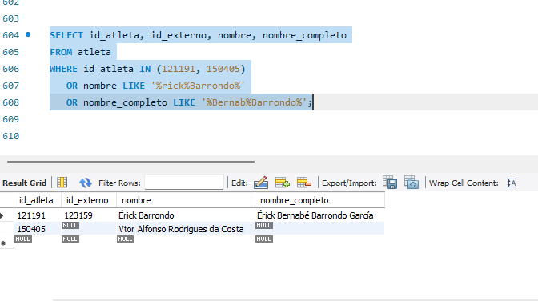
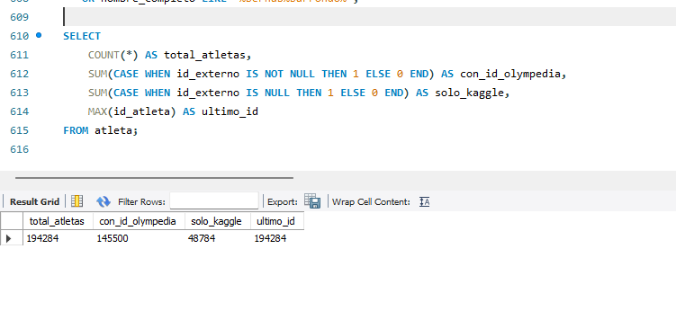

# DOCUMENTO TÉCNICO Y DECISIONES DE ARQUITECTURA ETL (FASE 1)
**Proyecto: Base de Datos Unificada de Juegos Olímpicos (1896-2024)**  
**Curso: Sistemas de Bases de Datos 2 — USAC**  
**Grupo 18**

---

### 1. Respuestas a los Puntos Clave de Decisión Técnica

* **Deduplicación de atletas (`athlete_id` / `ID` / `player_id`):**
  * **Fuente de verdad maestra:** Se toma la base biográfica de Olympedia (`bios1.csv` crudo enriquecido con coordenadas de `clean-data/bios_locs.csv`) como el catálogo maestro inicial para la tabla `atleta`. Su identificador original se almacena en el atributo `atleta.id_externo`.
  * **Clave de cruce en memoria (`matching key`):** El cruce entre fuentes se ejecuta mediante la tupla normalizada `(nombre_normalizado, sexo, anio_nacimiento_aprox)`. El campo `nombre_normalizado` se procesa convirtiéndolo a minúsculas, retirando acentos y diacríticos (normalización Unicode NFKD), sustituyendo signos de puntuación por espacios (evitando la fusión de palabras en guiones como `Jean-Pierre` $\rightarrow$ `jean pierre`), suprimiendo el carácter separador viñeta (`•`), aplicando un diccionario fonético-ortográfico de restauración de vocales mutiladas por scraping defectuoso (`_CORRUPTED_TOKEN_MAP`), y admitiendo sufijos dinásticos y numerales romanos (`ii`, `iii`, `iv`, `jr`).
  * **Resolución de inserción:** Si un registro de Kaggle o de París 2024 coincide con un atleta existente (por clave canónica o por subconjunto estricto de tokens $\ge 3$ caracteres o sufijos dinásticos), se reutiliza su `id_atleta` (clave primaria autoincremental). Se prohíbe el emparejamiento por subconjunto en monónimos aislados para proteger homónimos. Si no existe coincidencia previa en el maestro, se inserta una nueva tupla en `atleta` asignando `id_externo = NULL`.

* **Jerarquía Deporte -> Disciplina -> Evento ("Disciplina Puente"):**
  * **Confirmación de la regla:** Se ratifica la implementación de la disciplina puente para todas las fuentes.
  * **Justificación de integridad referencial:** En el esquema `olimpiada2s.sql`, los atributos `evento.id_disciplina` y `disciplina.id_deporte` son `INT NULL` (admiten nulos por diseño del DDL). Sin embargo, la estrategia de disciplina puente garantiza que en la práctica siempre se asigne un valor válido, evitando eventos o disciplinas huérfanas.
  * **Mapeo programático:** Debido a que Kaggle únicamente incluye `Sport` y `Event` (omitiendo la disciplina), mientras que Olympedia incluye `Discipline` y `Event`, cuando una fuente no contenga disciplina intermedia se crea automáticamente un registro en `disciplina` donde `disciplina.nombre = deporte.nombre`. Esto garantiza que ningún evento quede huérfano y que las consultas con `JOIN` entre las tres entidades operen de forma consistente.

* **Vinculación de `populations.Country Code`:**
  * **Vínculo directo:** El campo `Country Code` de `populations.csv` se enlaza directamente contra `pais.codigo_pais`.
  * **Alineación de estándares:** Los valores de `Country Code` en `populations.csv` corresponden al estándar ISO 3166-1 alpha-3 del Banco Mundial (por ejemplo `GUA`, `ARG`, `ESP`, `FRA`).
  * **Resolución de claves foráneas:** En el esquema relacional, la tabla `poblacion_pais` depende de `pais(id_pais)`. El script de carga obtiene el `id_pais` buscando la coincidencia exacta entre `populations['Country Code']` y `pais.codigo_pais`.

* **Estado del Diagrama Entidad-Relación (Persona 1):**
  * **Estado actual:** El diagrama consolidado `ERD-OLIMIADAS-G18.png` se encuentra al día y no requiere modificaciones.
  * **Consistencia con el DDL:** En el diagrama final, la entidad `ATLETA` ya contiene las columnas recuperadas de la data cruda (`afiliacion`, `apodo`, `titulo`, `nombre_original`, `orden_nombre`).
  * **Atributos corregidos:** La entidad `OLIMPIADA` define `temporada varchar(30)`, `PARTICIPACION` incluye `es_empate tinyint`, y `DISCIPLINA` tiene su clave primaria propia `PK id_disciplina`. La estructura visual coincide con el script `olimpiada2s.sql`.

* **Tratamiento de Mojibake y Caracteres Corruptos:**
  * **Doble codificación:** Los archivos presentan textos donde secuencias UTF-8 fueron interpretadas erróneamente bajo Windows-1252 / CP1252 al momento de guardarse (por ejemplo `Jean-François` en vez de `Jean-François`).
  * **Función de saneamiento universal:** Antes de almacenar o procesar cualquier cadena de texto en Python, se ejecuta una rutina que recodifica el texto a bytes en `cp1252` y lo decodifica en `utf-8`, sustituyendo además el carácter viñeta (`•`) por un espacio simple.

* **Archivos de Entrada Seleccionados para el ETL:**
  * `athletes/bios.csv` (o `bios1.csv`): Archivo crudo con información biográfica, roles, títulos, afiliaciones y nombres originales.
  * `clean-data/bios_locs.csv`: Archivo de referencia para extraer `lat` y `long` cruzando por `athlete_id`.
  * `results/results.csv` (o `results1.csv`): Archivo crudo con resultados históricos de eventos, posiciones textuales y marcas de empate.
  * `clean-data/noc_regions.csv`: Catálogo maestro de códigos NOC, nombres de regiones y notas territoriales.
  * `clean-data/populations.csv`: Serie demográfica histórica (1960–2023) en formato tabular ancho.
  * `athlete_events.csv`: Dataset de Kaggle (1896–2016) para extraer métricas puntuales por edición (`Age`, `Height`, `Weight`).
  * `olympics_dataset.csv`: Dataset de Kaggle (1896–2024) para incorporar medallistas y eventos de Tokio 2020 y París 2024.

---

### 2. Aclaración Estratégica sobre los Datasets e Ingeniería Inversa

* **Ingesta de `bios` y `results` crudos:** Se utiliza la data cruda (`bios1.csv` y `results1.csv`) como insumo primario en cumplimiento directo con la instrucción del catedrático.
* **Ingeniería inversa sobre `clean_data.ipynb`:** El notebook de Keith Galli se toma como una guía algorítmica para reutilizar sus patrones de expresiones regulares (extracción de fechas de nacimiento/muerte, separación de altura/peso en centímetros y kilogramos, y aislamiento de ciudad, región y país en cadenas compuestas). La corrección fundamental sobre su metodología consiste en **no descartar columnas**, manteniendo atributos como `Affiliations`, `Nick/petnames`, `Title(s)` y `Original name` en la base de datos.
* **Rol de los archivos auxiliares de la Fuente 1:**
  * `noc_regions.csv` y `populations.csv` no son limpiezas de atletas, sino catálogos dimensionales externos (el primero del Comité Olímpico Internacional y el segundo del Banco Mundial) que se cargan directamente en las tablas `noc`, `pais` y `poblacion_pais`.
  * `bios_locs.csv` se emplea exclusivamente para extraer las columnas de latitud y longitud calculadas previamente, asociándolas al atleta mediante `athlete_id` sin necesidad de ejecutar llamadas lentas a APIs externas de geocodificación.
* **Estrategia de carga por capas:**
  * **Capa Base (Fuente 1):** Procesa la data cruda biográfica y de resultados de Olympedia (1896–2022).
  * **Capa de Enriquecimiento (Fuente 2 y 4):** Cruza `athlete_events.csv` mediante un `UPDATE` no destructivo sobre las participaciones existentes emparejadas por atleta y edición `(id_atleta, id_olimpiada)` mediante solapamiento léxico de tokens del evento (`extract_event_tokens`) y coincidencia de medalla, registrando la edad, altura y peso específicos de la edición en la tabla `participacion` sin duplicar filas transaccionales ni preseas.
  * **Capa de Actualización (Fuente 3):** Cruza `olympics_dataset.csv` para añadir los resultados y medallistas de Tokio 2020 y París 2024 que no existían en las fuentes anteriores. Para ediciones históricas ($\le 2016$), actualiza de forma idempotente las medallas que figuraban como `'NA'` a preseas de podio sin duplicar participaciones.

---

### 3. Pipeline ETL de Limpieza y Transformación en Python

```text
[Data Cruda: bios1.csv + results1.csv]
   │  (Ingeniería inversa de clean_data.ipynb preservando columnas)
   ├── 1. Reparación de codificación (CP1252 / Mojibake -> UTF-8)
   ├── 2. Parseo Regex de Born/Died (fechas y ciudades) y Measurements (cm/kg)
   ├── 3. Enriquecimiento geográfico (merge con bios_locs.csv por athlete_id)
   ├── 4. Mapeo categórico (Sex: 'Male'/'Female' -> 'M'/'F'; Medallas: NaN -> 'NA')
   ├── 5. Estandarización de ediciones (Games -> Year + Season + City)
   ├── 6. Pivoteo demográfico de populations.csv (formato ancho a filas)
   ├── 7. Integración de Fuentes 2 y 4 (UPDATE no destructivo de edad, altura_reg, peso_reg)
   ├── 8. Incorporación de Fuente 3 (ediciones 2020 y 2024)
   └── 9. Inserción directa en MySQL respetando orden de dependencias
```

* **Fase 1: Reparación de caracteres y texto:**
  * Corrección de mojibake mediante decodificación segura `cp1252` a `utf-8`.
  * Eliminación de la viñeta separadora (`•`) en los nombres de atletas.
* **Fase 2: Extracción y parseo estructurado:**
  * Parseo de fechas en `Born` y `Died` usando la expresión regular `r'(\d+ \w+ \d{4}|\d{4})'` y conversión a tipo fecha estándar (`YYYY-MM-DD`).
  * Extracción de componentes de nacimiento con `r'in ([\w\s()-]+), ([\w\s-]+) \((\w+)\)'` para aislar `ciudad_nac`, `region_nac` y código de país.
  * Separación de `Measurements` hacia `altura_cm` y `peso_kg` en formato decimal continuo.
* **Fase 3: Normalización categórica:**
  * Homologación de género: valores `'Male'` se transforman en `'M'` y `'Female'` en `'F'`.
  * Homologación de medallas: valores nulos (`NaN`), cadenas vacías o `'No medal'` se asignan obligatoriamente al ID de `'NA'` en la tabla `medalla`.
  * Detección de empates: si el campo `Pos` contiene el símbolo `=`, se activa el indicador booleano `es_empate = TRUE`.
* **Fase 4: Transformación demográfica (Banco Mundial):**
  * Ejecución de `pandas.melt()` sobre `populations.csv` para transformar las 64 columnas anuales (`1960` a `2023`) en registros normalizados de series de tiempo con la estructura `(id_pais, anio, poblacion)`.
* **Fase 5: Secuencia de carga en base de datos:**
  Para evitar inconsistencias por llaves foráneas (`FOREIGN KEY`), las inserciones se realizan en el siguiente orden secuencial estricto:
  1. `medalla` (Semilla DDL existente)
  2. `pais` (Catálogo maestro geográfico derivado de `noc_regions.csv`, `populations.csv` y países de nacimiento)
  3. `poblacion_pais` (Registros desanidados enlazados a `id_pais`)
  4. `noc` (Comités Olímpicos vinculados a su correspondiente `id_pais`)
  5. `sede` (Ciudades anfitrionas con clave única `(ciudad, id_pais)`)
  6. `olimpiada` (Ediciones enlazadas a `id_sede` con clave única `(anio, temporada)`)
  7. `deporte` (Nombres únicos de deportes)
  8. `disciplina` (Disciplinas asociadas a `id_deporte`, incluyendo disciplinas puente)
  9. `evento` (Eventos asociados a `id_disciplina`)
  10. `equipo` (Equipos deportivos con clave única `(nombre, id_noc)`)
  11. `atleta` (Maestro biográfico unificado)
  12. `participacion` (Tabla transaccional con llaves a atleta, evento, olimpiada, equipo y medalla)

---

### 4. Requerimientos para los Stored Procedures (Persona 3)

* **Procedimiento 1: Historial y Ficha del Atleta (`sp_consultar_atleta`):**
  * **Parámetros:**
    * `p_nombre VARCHAR(120)`: Búsqueda flexible por coincidencia parcial (`LIKE CONCAT('%', p_nombre, '%')`).
    * `p_anio SMALLINT`: Filtro temporal opcional (permite `NULL` para omitir el filtro).
    * `p_deporte VARCHAR(120)`: Filtro por deporte opcional (permite `NULL`).
    * `p_pais VARCHAR(120)`: Filtro por nombre o código de país opcional (permite `NULL`).
  * **Reglas de negocio y salida:**
    * Despliega dos bloques de información: un resumen con los datos biográficos del atleta (nombre completo, sexo, fecha y lugar de nacimiento, altura y peso base), y una lista detallada de sus participaciones (año, temporada, sede, deporte, evento, puesto alcanzado y medalla obtenida).
    * Si el parámetro `p_nombre` coincide con múltiples atletas, limita la salida o agrupa por atleta para evitar desbordamiento de filas.

* **Procedimiento 2: Desempeño y Registro Histórico por País (`sp_consultar_pais`):**
  * **Parámetros:**
    * `p_pais VARCHAR(120)`: Nombre del país o código NOC de 3 letras.
    * `p_anio_inicio SMALLINT`: Límite inferior del rango temporal (permite `NULL`).
    * `p_anio_fin SMALLINT`: Límite superior del rango temporal (permite `NULL`).
    * `p_solo_medallas BOOLEAN`: Bandera booleana para filtrar exclusivamente participaciones donde se obtuvo medalla (excluyendo `'NA'`).
  * **Reglas de negocio y salida:**
    * **Condición de Sede Histórica:** Consulta sobre las tablas `sede`, `pais` y `olimpiada` para verificar si el país albergó alguna edición de los juegos, listando explícitamente las ciudades anfitrionas y los años correspondientes.
    * **Medallero Histórico Acumulado:** Retorna el conteo consolidado de medallas mediante agregaciones:
      $$\text{Total Oro} = \sum(\text{Medalla} = \text{'Gold'}), \quad \text{Total Plata} = \sum(\text{Medalla} = \text{'Silver'}), \quad \text{Total Bronce} = \sum(\text{Medalla} = \text{'Bronze'})$$
    * **Control de volumen:** Prohibido emitir un `SELECT *` de todas las participaciones del país. La información debe devolverse agrupada por edición olímpica y disciplina deportiva para responder de forma ágil y controlada durante la evaluación técnica.

    