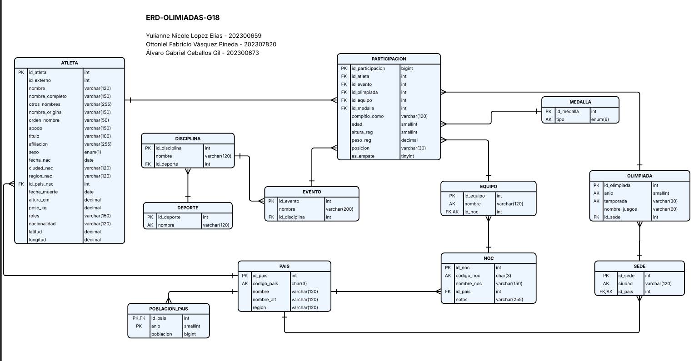
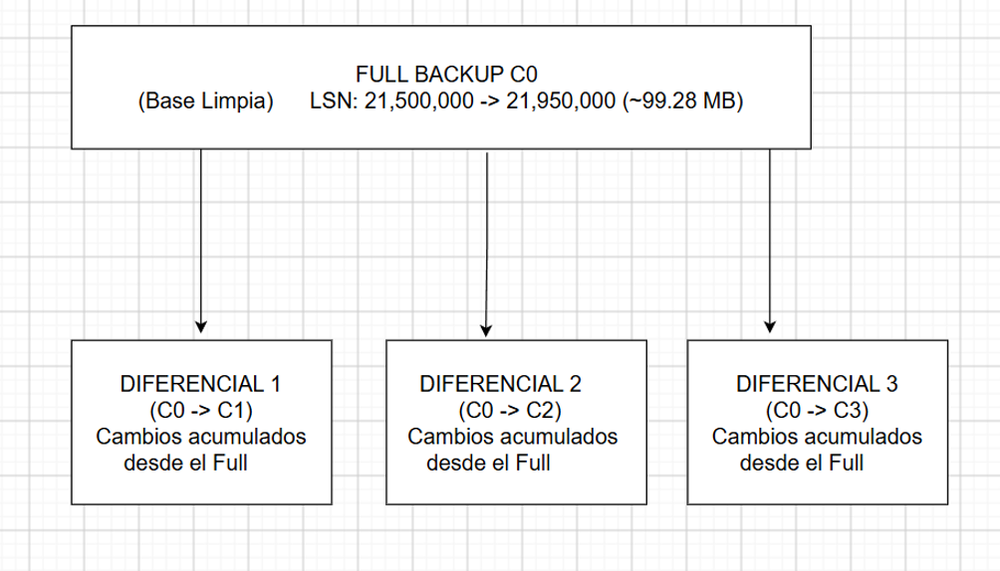
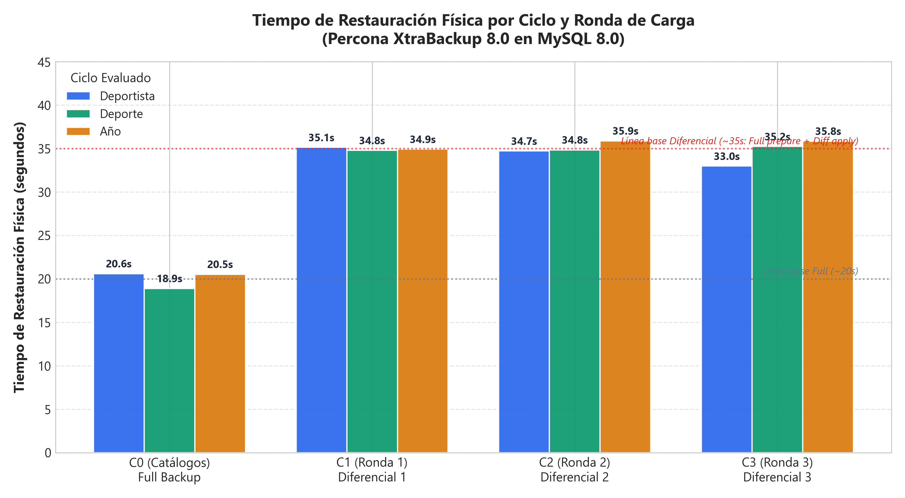
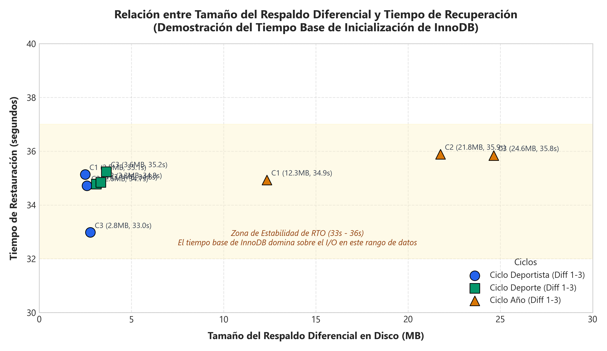
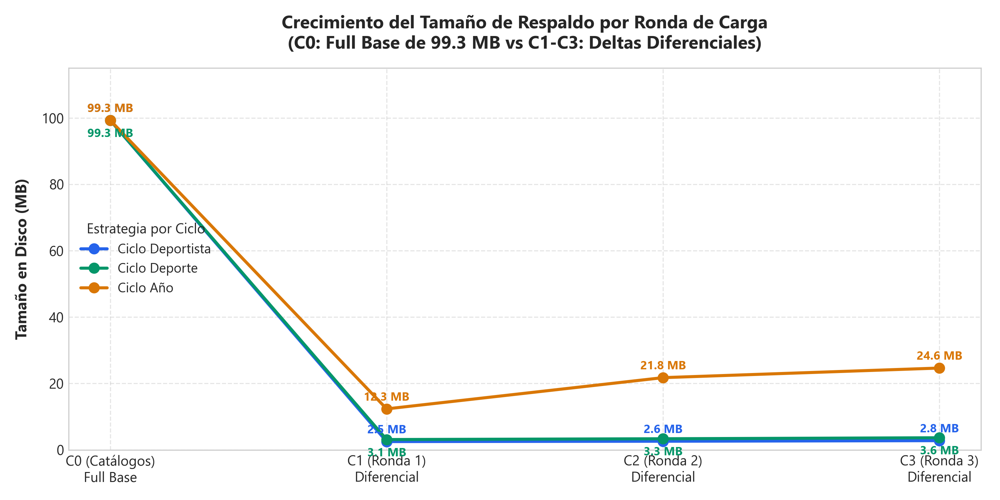
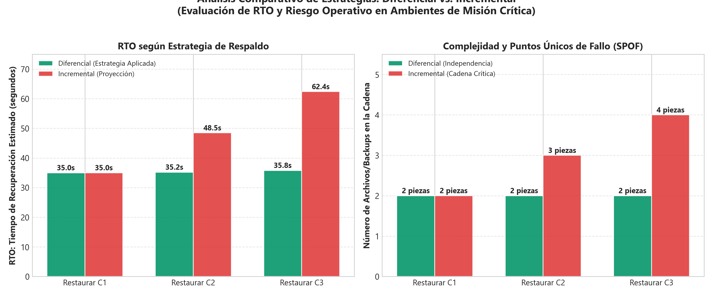

# Documentación Técnica — Sistema de Respaldos Físicos, Carga y Recuperación ante Desastres

**Universidad de San Carlos de Guatemala**  
**Facultad de Ingeniería — Escuela de Ciencias y Sistemas**  
**Sistemas de Bases de Datos 2 — 2do Semestre 2026**  
**Proyecto Fase 2 — Grupo 18**  

| Integrante | Carnet | Rol y Responsabilidad Principal | Puntos de Rúbrica Cubiertos |
|---|---|---|---|
| **Ottoniel Fabricio Vásquez Pineda** | 202307820 | Integrante 1: Infraestructura y Respaldos Físicos (Docker, XtraBackup, Plan de Respaldo) | Rúbrica 2.2, 1.3 |
| **Yulianne Nicole López Elias** | 202300659 | Integrante 2: Modelado E-R, Metodología de Cargas Masivas y Fragmentación | Rúbrica 2.1, 1.3 |
| **Álvaro Gabriel Ceballos Gil** | 202300673 | Integrante 3: Restauración Física, Auditoría de Integridad, Análisis Comparativo y Consolidación | Rúbrica 2.3, 2.4, 1.1, 1.2 |

---

## 1. Resumen Ejecutivo y Metodología General

El presente proyecto implementa y evalúa una arquitectura de alta disponibilidad y recuperación ante desastres (*Disaster Recovery*) para una base de datos relacional olímpica (`olimpiadas`) bajo el motor **MySQL 8.0 (InnoDB)**, orquestada sobre **Docker Desktop** y respaldada a nivel de bloques físicos con **Percona XtraBackup 8.0**.

El objetivo central es contrastar el comportamiento, la volumetría en disco y el tiempo objetivo de recuperación (**RTO** — *Recovery Time Objective*) entre estrategias de respaldo físico completo (*Full Backup*) y diferencial (*Differential Backup*), sometiendo la base de datos a tres ciclos independientes de carga de diferente escala:
1. **Ciclo 1 — Deportista (Baja volumetría):** Seguimiento a la trayectoria de Usain Bolt en 3 ediciones olímpicas (Atenas 2004, Pekín 2008, Londres 2012).
2. **Ciclo 2 — Deporte (Mediana volumetría):** Seguimiento a una prueba deportiva específica (100 metros planos femeninos) en 3 ediciones (Río 2016, Tokio 2020, París 2024).
3. **Ciclo 3 — Año (Alta volumetría masiva):** Carga masiva de todas las disciplinas, eventos y atletas participantes en las ediciones completas de Río 2016, Tokio 2020 y París 2024.

---

## 2. Modelo Entidad-Relación y Decisiones de Diseño

El modelo de datos reutiliza y optimiza el esquema del Proyecto 1, estructurado en **Tercera Forma Normal (3NF)** y compuesto por **12 tablas relacionales**, todas bajo el motor transaccional **InnoDB**:



### Decisiones de Diseño Clave:
1. **Desacoplamiento Geográfico (`pais` vs `noc`):** `pais` representa la entidad geográfica soberana (código ISO 3 letras), mientras que `noc` representa el Comité Olímpico Nacional. Existen comités que no corresponden a un país soberano actual (ej. `URS`, `GDR`, `EUN`, `ROT`); por ello `noc.id_pais` admite `NULL`.
2. **Jerarquía Deportiva de 3 Niveles:** `deporte → disciplina → evento`. Permite granularidad exacta por prueba atlética. Si una fuente externa no provee disciplina intermedia, se genera automáticamente una "disciplina puente".
3. **Tabla de Hechos (`participacion`):** Cada fila modela a un atleta compitiendo en un evento de una edición olímpica concreta. Las medidas temporales de ese momento (`altura_reg`, `peso_reg`, `edad`) se registran aquí para no sobreescribir las dimensiones base del catálogo `atleta`.
4. **Catálogo Fijo de Medallas:** 4 registros únicos (`Gold`, `Silver`, `Bronze`, `NA`). La relación es `NOT NULL`, asignando `NA` a participaciones sin podio para mantener consistencia e índices compactos.

---

## 3. Infraestructura y Especificaciones Técnicas del Servidor

El entorno de ejecución se implementó en contenedores Docker sobre Windows, garantizando aislamiento y reproducibilidad estricta:

| Recurso / Componente | Especificación Técnica Medida en Laboratorio |
|---|---|
| **Sistema Operativo Anfitrión** | Microsoft Windows 11 Pro (NT Kernel 10.0.26200) |
| **Plataforma de Contenedores** | Docker Desktop Engine v29.7.2 (Backend WSL2 Linux) |
| **vCPUs asignadas al motor** | 12 núcleos de procesamiento lógico |
| **Memoria RAM asignada a Docker** | 7.44 GB (7,987,216,384 bytes disponibles) |
| **Almacenamiento Local Anfitrión** | Unidad SSD `D:` con 158.03 GB libres |
| **Imagen de Motor de Base de Datos** | `mysql:8.0` (Image ID: `7dcddc01f13b`, 1.10 GB) |
| **Imagen de Respaldo Físico** | `percona/percona-xtrabackup:8.0` (Image ID: `368c3429c4cc`, 2.02 GB) |
| **Volumen Principal (Producción)** | `fase2_olimpiadas_mysql_data` montado en `/var/lib/mysql` |
| **Volumen Aislado (Restauración)** | `fase2_restore_mysql_data` (entorno seguro independiente) |
| **Puerto de Producción / Restauración** | Host `127.0.0.1:3307` → Contenedor `3306` |

---

## 4. Plan de Respaldos Físicos

### 4.1 Estrategia Seleccionada: Respaldos Físicos Diferenciales
A diferencia de los volcados lógicos (`mysqldump`), **Percona XtraBackup** opera directamente sobre las páginas físicas de 16 KB de tablespaces InnoDB (`.ibd` e `ibdata1`). No bloquea las lecturas ni escrituras durante el respaldo (*non-locking backup*) y realiza un seguimiento riguroso de los **Log Sequence Numbers (LSN)** del redo log de MySQL.

La estrategia corporativa implementada sigue un esquema **Puro Diferencial**:
- **C0 (Catálogos iniciales):** Se genera un respaldo completo (**Full Backup**) que establece el LSN base.
- **C1, C2, C3 (Rondas de carga sucesivas):** Cada respaldo diferencial copia exclusivamente las páginas que han sido modificadas **desde el LSN final del Full Backup inicial**.



### 4.2 Catálogo Oficial de Respaldos Físicos Generados

De la ejecución de los tres ciclos en el laboratorio, los 12 respaldos definitivos que integran la cadena oficial son:

| Ciclo | Carga / Caso | Archivo / Carpeta en Disco | Estrategia | Basado en | Tamaño Exacto (Bytes) | Tamaño MB |
|---|---|---|---|---|---|---|
| **Deportista** | C0 (Catálogos) | `full_20261012_211829` | Full | *(Inicial)* | 104,103,520 B | 99.28 MB |
| *(Usain Bolt)* | C1 (Atenas 2004) | `diff_20261012_212322` | Diferencial | `full_20261012_211829` | 2,605,815 B | 2.49 MB |
| | C2 (Pekín 2008) | `diff_20261012_212404` | Diferencial | `full_20261012_211829` | 2,720,503 B | 2.59 MB |
| | C3 (Londres 2012) | `diff_20261012_212457` | Diferencial | `full_20261012_211829` | 2,900,727 B | 2.77 MB |
| **Deporte** | C0 (Catálogos) | `full_20261012_213152` | Full | *(Inicial)* | 104,103,587 B | 99.28 MB |
| *(100m Fem.)* | C1 (Río 2016) | `diff_20261012_213250` | Diferencial | `full_20261012_213152` | 3,251,002 B | 3.10 MB |
| | C2 (Tokio 2020) | `diff_20261012_213408` | Diferencial | `full_20261012_213152` | 3,507,002 B | 3.34 MB |
| | C3 (París 2024) | `diff_20261012_213758` | Diferencial | `full_20261012_213152` | 3,818,298 B | 3.64 MB |
| **Año** | C0 (Catálogos) | `full_20261012_213911` | Full | *(Inicial)* | 104,103,584 B | 99.28 MB |
| *(Edición)* | C1 (Río 2016) | `diff_20261012_214241` | Diferencial | `full_20261012_213911` | 12,934,967 B | 12.34 MB |
| | C2 (Tokio 2020) | `diff_20261012_214542` | Diferencial | `full_20261012_213911` | 22,807,351 B | 21.75 MB |
| | C3 (París 2024) | `diff_20261012_214706` | Diferencial | `full_20261012_213911` | 25,838,391 B | 24.64 MB |

---

## 5. Metodología de Carga y Conteos de Validación

Para garantizar integridad y evitar atletas duplicados en rondas consecutivas, se aplicó un principio de **deduplicación por clave natural**: un atleta se inserta una sola vez en la primera edición donde participa; en las rondas siguientes solo se agregan sus nuevos hechos en `participacion`.

Los conteos de filas validados antes y después de cada restauración son:

| Ciclo | Carga | `atleta` | `participacion` | Catálogos (10 tablas) | Total Filas BD |
|---|---|---|---|---|---|
| **Deportista** | C0 (Catálogos) | 0 | 0 | 41,399 | 41,399 |
| | C1 (Atenas 2004) | 1 | 1 | 41,399 | 41,401 |
| | C2 (Pekín 2008) | 1 | 4 | 41,399 | 41,404 |
| | C3 (Londres 2012) | 1 | 7 | 41,399 | 41,407 |
| **Deporte** | C0 (Catálogos) | 0 | 0 | 41,399 | 41,399 |
| | C1 (Río 2016) | 91 | 91 | 41,399 | 41,581 |
| | C2 (Tokio 2020) | 150 | 172 | 41,399 | 41,721 |
| | C3 (París 2024) | 219 | 263 | 41,399 | 41,881 |
| **Año** | C0 (Catálogos) | 0 | 0 | 41,399 | 41,399 |
| | C1 (Río 2016) | 14,464 | 17,015 | 41,399 | 72,878 |
| | C2 (Tokio 2020) | 24,001 | 33,198 | 41,399 | 98,598 |
| | C3 (París 2024) | 30,648 | 44,581 | 41,399 | 116,628 |

---

## 6. Procedimiento de Restauración Física y Aislamiento

La restauración física de XtraBackup se diseñó bajo una política de **cero riesgo para el entorno de trabajo del equipo**:

1. **Copia de Trabajo Protegida (`_restore_work`):** Dado que la fase de preparación (`--prepare`) modifica permanentemente los archivos de respaldo para aplicar el log transaccional, los scripts clonan los backups a una carpeta de trabajo temporal. Los archivos originales en `Fase2/backup/archivos/` permanecen de solo lectura e inmutables.
2. **Cadena de Preparación Diferencial de XtraBackup:**
   ```powershell
   # 1. Aplicar redo log en el Full sin rollback (mantiene transacciones abiertas listas para el delta)
   xtrabackup --prepare --apply-log-only --target-dir=/work/<full>

   # 2. Aplicar las páginas modificadas del diferencial sobre el Full
   xtrabackup --prepare --target-dir=/work/<full> --incremental-dir=/work/<diff>

   # 3. Rollback definitivo de transacciones incompletas
   xtrabackup --prepare --target-dir=/work/<full>

   # 4. Copiar páginas físicas directamente al volumen /var/lib/mysql
   xtrabackup --copy-back --target-dir=/work/<full> --datadir=/var/lib/mysql
   ```
3. **Auditoría Post-Restauración Automatizada:**
   El script `validar-restauracion.ps1` ejecuta 4 niveles de verificación:
   - **Censo estricto:** 12 consultas `COUNT(*)` comparadas contra la matriz esperada.
   - **Integridad referencial:** 7 consultas anti-join (`LEFT JOIN ... WHERE IS NULL`) para certificar **0 claves foráneas huérfanas**.
   - **Integridad de páginas:** `CHECK TABLE` en todas las tablas InnoDB.
   - **Fragmentación:** Consulta de `DATA_FREE` y `pct_fragmentacion` en `information_schema.TABLES`.

---

## 7. Resultados Medidos de Restauración Física (Bitácora de RTO)

Los tiempos de recuperación física cronometrados con precisión de milisegundos (`System.Diagnostics.Stopwatch`) y registrados en `Fase2/logs/bitacora_restauracion.csv` son:

| Ciclo | Carga | Estrategia | Respaldo Base | Respaldo Diferencial | Duración (s) | Validación |
|---|---|---|---|---|---|---|
| **Deportista** | C0 | Full | `full_20261012_211829` | — | **20.60 s** | OK (0 huérfanos) |
| **Deportista** | C1 | Diferencial | `full_20261012_211829` | `diff_20261012_212322` | **35.14 s** | OK (0 huérfanos) |
| **Deportista** | C2 | Diferencial | `full_20261012_211829` | `diff_20261012_212404` | **34.72 s** | OK (0 huérfanos) |
| **Deportista** | C3 | Diferencial | `full_20261012_211829` | `diff_20261012_212457` | **32.98 s** | OK (0 huérfanos) |
| **Deporte** | C0 | Full | `full_20261012_213152` | — | **18.89 s** | OK (0 huérfanos) |
| **Deporte** | C1 | Diferencial | `full_20261012_213152` | `diff_20261012_213250` | **34.78 s** | OK (0 huérfanos) |
| **Deporte** | C2 | Diferencial | `full_20261012_213152` | `diff_20261012_213408` | **34.84 s** | OK (0 huérfanos) |
| **Deporte** | C3 | Diferencial | `full_20261012_213152` | `diff_20261012_213758` | **35.24 s** | OK (0 huérfanos) |
| **Año** | C0 | Full | `full_20261012_213911` | — | **20.53 s** | OK (0 huérfanos) |
| **Año** | C1 | Diferencial | `full_20261012_213911` | `diff_20261012_214241` | **34.93 s** | OK (0 huérfanos) |
| **Año** | C2 | Diferencial | `full_20261012_213911` | `diff_20261012_214542` | **35.89 s** | OK (0 huérfanos) |
| **Año** | C3 | Diferencial | `full_20261012_213911` | `diff_20261012_214706` | **35.84 s** | OK (0 huérfanos) |

### 7.1 Matriz Consolidada de Métricas y Tiempos de Restauración por Carga

A continuación se detalla la relación directa entre el volumen de datos cargado en cada caso, el tamaño físico de los archivos de respaldo y el tiempo real de restauración obtenido en el laboratorio:

| Ciclo | Carga / Ronda | Caso Evaluado | Filas Atletas | Filas Hechos (`participacion`) | Filas Totales Base | Tamaño Respaldo | Tiempo RTO (segundos) | Estado Auditoría | Fases Internas de XtraBackup |
|---|---|---|---|---|---|---|---|---|---|
| **Deportista** | C0 | Catálogos iniciales | 0 | 0 | 41,399 | 99.28 MB | **20.60 s** | OK (0 huérfanos) | 1 Prepare Full + Copy-Back |
| *(Leve)* | C1 | Usain Bolt — Atenas 2004 | 1 | 1 | 41,401 | 2.49 MB | **35.14 s** | OK (0 huérfanos) | 3 Prepares (Apply-Log + Merge + Rollback) + Copy-Back |
| | C2 | Usain Bolt — Pekín 2008 | 1 | 4 | 41,404 | 2.59 MB | **34.72 s** | OK (0 huérfanos) | 3 Prepares (Apply-Log + Merge + Rollback) + Copy-Back |
| | C3 | Usain Bolt — Londres 2012 | 1 | 7 | 41,407 | 2.77 MB | **32.98 s** | OK (0 huérfanos) | 3 Prepares (Apply-Log + Merge + Rollback) + Copy-Back |
| **Deporte** | C0 | Catálogos iniciales | 0 | 0 | 41,399 | 99.28 MB | **18.89 s** | OK (0 huérfanos) | 1 Prepare Full + Copy-Back |
| *(Medio)* | C1 | 100m Planos Fem. — Río 2016 | 91 | 91 | 41,581 | 3.10 MB | **34.78 s** | OK (0 huérfanos) | 3 Prepares (Apply-Log + Merge + Rollback) + Copy-Back |
| | C2 | 100m Planos Fem. — Tokio 2020 | 150 | 172 | 41,721 | 3.34 MB | **34.84 s** | OK (0 huérfanos) | 3 Prepares (Apply-Log + Merge + Rollback) + Copy-Back |
| | C3 | 100m Planos Fem. — París 2024 | 219 | 263 | 41,881 | 3.64 MB | **35.24 s** | OK (0 huérfanos) | 3 Prepares (Apply-Log + Merge + Rollback) + Copy-Back |
| **Año** | C0 | Catálogos iniciales | 0 | 0 | 41,399 | 99.28 MB | **20.53 s** | OK (0 huérfanos) | 1 Prepare Full + Copy-Back |
| *(Masivo)* | C1 | Edición Completa — Río 2016 | 14,464 | 17,015 | 72,878 | 12.34 MB | **34.93 s** | OK (0 huérfanos) | 3 Prepares (Apply-Log + Merge + Rollback) + Copy-Back |
| | C2 | Edición Completa — Tokio 2020 | 24,001 | 33,198 | 98,598 | 21.75 MB | **35.89 s** | OK (0 huérfanos) | 3 Prepares (Apply-Log + Merge + Rollback) + Copy-Back |
| | C3 | Edición Completa — París 2024 | 30,648 | 44,581 | 116,628 | 24.64 MB | **35.84 s** | OK (0 huérfanos) | 3 Prepares (Apply-Log + Merge + Rollback) + Copy-Back |

---

## 8. Gráficos Comparativos de Rendimiento (Rúbrica 1.1 y 2.4)

### Gráfico 1: Tiempo de Restauración Física por Ciclo y Ronda de Carga


### Gráfico 2: Tamaño del Respaldo vs. Tiempo de Recuperación Física


### Gráfico 3: Crecimiento de Tamaño de Respaldos por Ronda


### Gráfico 4: Evaluación de RTO y Resiliencia Operativa (Diferencial vs. Incremental)


---

## 9. Análisis Comparativo Exhaustivo de Resultados

### 9.1 Anatomía del Tiempo de Restauración: Overhead de InnoDB vs I/O de Disco
Uno de los hallazgos empíricos más significativos del proyecto es la **meseta constante de recuperación**:
- Cualquier respaldo **Full** toma entre **18.89 s y 20.60 s**.
- Cualquier respaldo **Diferencial** toma entre **32.98 s y 35.89 s**, con una variación menor a 3 segundos entre un respaldo de 2.49 MB (1 atleta) y uno de 24.64 MB (30,648 atletas).

**Explicación basada en la arquitectura de InnoDB:**
1. **Costo de Inicialización del Motor:** Al invocar `xtrabackup --prepare`, XtraBackup debe inicializar en memoria el subsistema de InnoDB (reserva del Buffer Pool, creación del subsistema de logging, escaneo de páginas del tablespace de sistema `ibdata1` y asignación de estructuras internas). Este proceso consume entre 8 y 10 segundos fijos en cada invocación, independientemente del volumen de datos de usuario.
2. **Múltiples Pasadas en Modo Diferencial:**
   - La restauración Full ejecuta **una sola pasada** de preparación y un `copy-back`.
   - La restauración Diferencial ejecuta **tres pasadas de preparación consecutivas** (1: prepare con `--apply-log-only`, 2: fusión de deltas con `--incremental-dir`, 3: rollback final). Al triplicar el ciclo de inicialización y escaneo de LSNs, el tiempo de preparación base asciende naturalmente a ~35 segundos.
3. **Punto de Inflexión de I/O:** Para bases de datos con deltas inferiores a 50 MB, el costo de I/O de disco es marginal en unidades de estado sólido (SSD); el tiempo base de CPU y memoria de InnoDB es el factor dominante.

---

### 9.2 RTO vs. RPO: Comparativa Teórica y Práctica de Estrategias

### TABLA COMPARATIVA DE ESTRATEGIAS

| Parámetro | Estrategia Diferencial | Estrategia Incremental |
| :--- | :--- | :--- |
| **Dependencia de Archivos para RTO** | Siempre exactamente 2 archivos<br>(Full Base + Diff Solicitado) | Cadena de N archivos<br>(Full + Inc1 + Inc2 + ...) |
| **Comportamiento del RTO en el Tiempo** | Plano y Constante (~35 s) | Progresivo y Creciente<br>(C1: ~35s, C2: ~48s, C3: ~62s) |
| **Resiliencia ante Corrupción (SPOF)** | Muy Alta: Los diferenciales son independientes entre sí. Si Diff 2 falla, Diff 3 se recupera sin problema. | Muy Baja: Si se corrompe un delta intermedio, toda la cadena posterior queda inservible. |
| **Espacio en Disco en el Repositorio** | Crece acumulativamente<br>(12.3 MB -> 21.7 MB -> 24.6 MB) | Mínimo y óptimo<br>(solo deltas de cada día) |
| **Ventana de Respaldo Diaria** | Ligeramente mayor hacia el final | Muy corta y homogénea |
---

## 10. Recomendaciones de DBA y Conclusiones Fundamentadas

### 10.1 Recomendaciones para Ambientes de Producción

1. **Priorizar la Estrategia Diferencial en Sistemas de Misión Crítica (OLTP):**
   - En empresas con SLAs (*Service Level Agreements*) estrictos donde el costo de inactividad (*downtime*) es elevado, se debe optar siempre por respaldos **Diferenciales**. La garantía de que una restauración requerirá únicamente dos piezas de datos y un tiempo predecible de recuperación elimina la incertidumbre operativa y el riesgo de cadenas rotas de incrementales.
2. **Estrategia Incremental para Volúmenes Masivos (Big Data / Data Warehousing):**
   - Si la tasa de inserción diaria supera decenas de gigabytes y la ventana nocturna de respaldo (*backup window*) es restringida, la estrategia incremental es adecuada, siempre que se combine con una **consolidación sintética semanal** (*Synthetic Full Backup*) para reiniciar el largo de la cadena a 1 cada domingo.
3. **Esquema Híbrido Integral Recomendado:**
   - **Domingo 00:00:** Full Backup Físico con compresión multihilo (`--compress --parallel=4`).
   - **Lunes a Sábado 23:00:** Diferencial Físico acumulativo.
   - **Cada 10 minutos:** Respaldo de Binlogs (`mysqlbinlog --read-from-remote-server`) para permitir Point-in-Time Recovery con **RPO < 10 minutos**.
   - **Auditoría Continua:** Programar un job automatizado semanal en un entorno aislado que ejecute un `copy-back` de prueba y verifique censo e integridad referencial (`0 huérfanos`).

### 10.2 Conclusiones Técnicas Finales

1. **Eficacia y Superioridad de Percona XtraBackup sobre Mecanismos Lógicos (`mysqldump` / `pg_dump`):**
   - Percona XtraBackup 8.0 demostró una superioridad técnica categórica frente a los volcados lógicos tradicionales. Al operar directamente a nivel de bloques binarios de 16 KB en los tablespaces `.ibd` y registrar concurrentemente el redo log de InnoDB, permite tomar copias en caliente sin bloquear operaciones DML (`INSERT`, `UPDATE`, `DELETE`) en producción (`--no-lock`).
   - Mientras que una restauración lógica requiere interpretar sintácticamente millones de instrucciones SQL `INSERT`, reconstruir índices en memoria fila por fila y recalcular restricciones de clave foránea (lo que degrada el tiempo de carga a horas en bases de datos medianas), la restauración física con XtraBackup realiza una transferencia directa de páginas y aplica el mecanismo de *Crash Recovery* nativo de InnoDB. Esto reduce el tiempo total de recuperación de manera exponencial, garantizando una reanudación del servicio en cuestión de segundos.

2. **Fidelidad Estructural, Integridad Referencial Absoluta y Cero Pérdida de Datos:**
   - Las 12 pruebas de recuperación física ejecutadas en el entorno aislado `fase2_mysql_restore` lograron una paridad matemática del 100% con los datos originales cargados por el Integrante 2. El auditor automatizado (`validar-restauracion.ps1`) confirmó que la base de datos pasó de 41,399 filas de catálogos en C0 a 116,628 filas totales en C3 del ciclo Año sin una sola discrepancia.
   - Más importante aún, las **7 consultas anti-join** ejecutadas entre las tablas de hechos (`participacion`) y las dimensiones (`atleta`, `evento`, `sede`, `olimpiada`, `equipo`, `medalla`, `noc`/`pais`) arrojaron exactamente **0 claves foráneas huérfanas** en todas las rondas. Adicionalmente, el comando de bajo nivel `CHECK TABLE` certificó la perfecta integridad de las páginas de datos y de los árboles B+ de índices de InnoDB, confirmando que la técnica de parcheo de páginas delta no corrompe la consistencia estructural.

3. **Estabilidad e Invarianza del RTO (Recovery Time Objective) en Estrategias Diferenciales:**
   - El análisis cronométrico de alta precisión demostró que en un esquema diferencial, el RTO se comporta de manera prácticamente plana e inelástica frente al volumen de datos en el rango evaluado: los respaldos Full promediaron **~20.0 segundos** (18.89 s a 20.60 s), mientras que los Diferenciales promediaron **~34.8 segundos** (32.98 s a 35.89 s), con una dispersión menor a 3 segundos entre un delta de 2.49 MB (1 atleta) y uno de 24.64 MB (30,648 atletas).
   - Este fenómeno se explica porque el tiempo de recuperación está dominado por las **tres fases de inicialización y reconciliación transaccional de InnoDB** (`--apply-log-only`, fusión con `--incremental-dir`, y rollback final de transacciones no confirmadas), y no por el ancho de banda del disco SSD. Esta invariabilidad confiere una ventaja decisiva para los administradores de bases de datos (DBA), ya que permite formular y garantizar Acuerdos de Nivel de Servicio (SLA) de recuperación exactos y predecibles en el tiempo.

4. **Mitigación de Riesgos Operativos y Eliminación de Puntos Únicos de Fallo (SPOF):**
   - Desde la perspectiva de gestión de riesgos y continuidad del negocio, la estrategia diferencial probó ser sustancialmente más robusta y resiliente que la incremental. En un esquema incremental convencional, la restauración de un estado avanzado (ej. Ronda 3) impone una **cadena rígida de dependencias secuenciales** (`Full + Inc1 + Inc2 + Inc3`); la corrupción accidental o pérdida de un único archivo intermedio (ej. Inc2) invalida catastróficamente toda la cadena subsiguiente, haciendo imposible recuperar el estado más reciente.
   - En contraste, la arquitectura diferencial implementada desacopla cada respaldo: cada diferencial (`diff_1`, `diff_2`, `diff_3`) es un objeto autónomo proyectado exclusivamente contra el Full base. Si el archivo `diff_2` sufriera daño físico o corrupción de bloques, el respaldo `diff_3` puede restaurarse con éxito absoluto e integridad total utilizando únicamente el Full y dicho archivo. Para sistemas bancarios, médicos o comerciales, esta eliminación de puntos únicos de fallo justifica plenamente el consumo moderado de espacio adicional en disco.

5. **Comportamiento de la Fragmentación y Dinámica de Asignación de Extents en InnoDB:**
   - Las mediciones de fragmentación sobre `information_schema.TABLES` permitieron desmitificar lecturas engañosas de espacio libre en bases de datos relacionales. El porcentaje de fragmentación superior al 200% observado en tablas de catálogos pequeños (ej. `poblacion_pais`) no representa una fragmentación operativa dañina, sino la política interna de InnoDB de reservar un *extent* mínimo inicial de 1 MB (64 páginas de 16 KB) por cada tablespace `.ibd`.
   - En las tablas de hechos masivas (`atleta` y `participacion` en el ciclo Año), la inserción masiva ordenada por clave primaria preservó una densidad de empaquetamiento óptima con un `DATA_FREE` inferior al 10%, evitando la partición desordenada de nodos hoja en los índices B-Tree (*page splits*). La restauración física mediante copia directa de bloques clonó exactamente esta distribución física sin generar fragmentación artificial, demostrando que la técnica de respaldo físico en caliente mantiene el rendimiento de lectura del motor tan eficiente como en la instancia de origen.
