# Manual de Usuario Consolidado — Administración, Carga, Respaldo y Restauración Física

**Universidad de San Carlos de Guatemala**  
**Facultad de Ingeniería — Escuela de Ciencias y Sistemas**  
**Sistemas de Bases de Datos 2 — 2do Semestre 2026**  
**Proyecto Fase 2 — Grupo 18**  

| Integrante | Carnet | Rol |
|---|---|---|
| **Ottoniel Fabricio Vásquez Pineda** | 202307820 | Integrante 1 (Infraestructura y Respaldos) |
| **Yulianne Nicole López Elias** | 202300659 | Integrante 2 (Cargas de Datos y Validación) |
| **Álvaro Gabriel Ceballos Gil** | 202300673 | Integrante 3 (Restauración y Consolidación) |

---


## 1. Requisitos del Sistema y Preparación del Entorno

### 1.1 Software y Herramientas Requeridas
- **Sistema Operativo:** Windows 10/11 con **Docker Desktop** instalado y en ejecución (con motor WSL2 o Hyper-V).
- **Consola:** **PowerShell 5.1 o 7.x**.
- **Cliente de Base de Datos:** **MySQL Workbench 8.0** (u otro cliente gráfico estándar).
- **Espacio en Disco:** Al menos 5 GB de espacio libre en disco para almacenar el volumen de MySQL y la carpeta de respaldos.

### 1.2 Configuración Inicial de Credenciales
Antes de ejecutar cualquier comando, debe clonar las plantillas de configuración en la carpeta `Fase2`:

```powershell
# Ejecutar desde la raíz del repositorio:
Copy-Item Fase2/.env.example Fase2/.env
Copy-Item Fase2/backup/xtrabackup.cnf.example Fase2/backup/xtrabackup.cnf
```

Editar ambos archivos (`Fase2/.env` y `Fase2/backup/xtrabackup.cnf`) y asignar **la misma contraseña local** (por defecto `admin`).  
> **Nota de Seguridad:** Los archivos `.env` y `xtrabackup.cnf` contienen credenciales locales y se encuentran excluidos del repositorio Git mediante `.gitignore`.

### 1.3 Permitir Ejecución de Scripts en PowerShell
Si PowerShell restringe la ejecución de scripts `.ps1`, habilitarla en la sesión actual:
```powershell
Set-ExecutionPolicy -Scope Process -ExecutionPolicy Bypass
```

### 1.4 Inicio y Detención del Entorno Principal
Para arrancar o detener el contenedor principal de MySQL:

- **Iniciar:** Ejecutar `.\Fase2\Start.bat` o:
  ```powershell
  docker compose --project-directory Fase2 --env-file Fase2/.env -f Fase2/docker-compose.yml up -d mysql
  ```
- **Detener conservando los datos:** Ejecutar `.\Fase2\stop.bat` o:
  ```powershell
  docker compose --project-directory Fase2 --env-file Fase2/.env -f Fase2/docker-compose.yml down
  ```
- **Reiniciar desde cero (borrar volumen):**
  ```powershell
  docker compose --project-directory Fase2 --env-file Fase2/.env -f Fase2/docker-compose.yml down -v
  ```

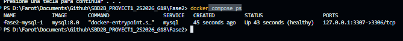

---

## 2. Parámetros de Conexión a MySQL

Para conectarse desde MySQL Workbench o cualquier cliente SQL:

| Parámetro | Valor de Conexión |
|---|---|
| **Hostname / Dirección IP** | `127.0.0.1` (o `localhost`) |
| **Puerto del Servidor** | **`3307`** *(Importante: no usar el 3306 para no colisionar con Fase 1)* |
| **Usuario** | `root` |
| **Contraseña** | La definida en `Fase2/.env` (ej. `admin`) |
| **Base de Datos por Defecto** | `olimpiadas` |

> El contenedor ejecuta automáticamente el script DDL (`Fase2/ddl/olimpiada2s.sql`) la primera vez que se inicia con un volumen vacío.

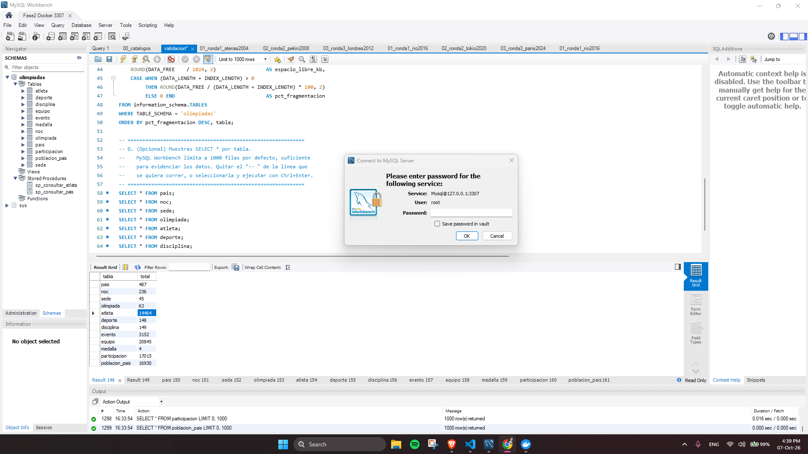

---

## 3. Guía de Ejecución de Cargas Masivas de Datos

El proyecto define **tres ciclos independientes** de carga: `deportista`, `deporte` y `anio`. Cada ciclo debe realizarse sobre una base limpia.

### 3.1 Flujo de Carga para un Ciclo
1. **Reiniciar el entorno a estado vacío:**
   ```powershell
   docker compose --project-directory Fase2 --env-file Fase2/.env -f Fase2/docker-compose.yml down -v
   .\Fase2\Start.bat
   ```
2. **Carga Inicial de Catálogos (C0):**
   - Abrir en Workbench `Fase2/carga/00_catalogos.sql`.
   - Ejecutar el script completo (`Ctrl+Shift+Enter`). Carga las 10 tablas de dimensiones (41,399 filas en total).
3. **Ronda 1 (C1):**
   - Abrir y ejecutar `Fase2/carga/<ciclo>/01_ronda1_*.sql`.
4. **Ronda 2 (C2):**
   - Abrir y ejecutar `Fase2/carga/<ciclo>/02_ronda2_*.sql`.
5. **Ronda 3 (C3):**
   - Abrir y ejecutar `Fase2/carga/<ciclo>/03_ronda3_*.sql`.

*Donde `<ciclo>` corresponde a `deportista`, `deporte` o `anio`.*

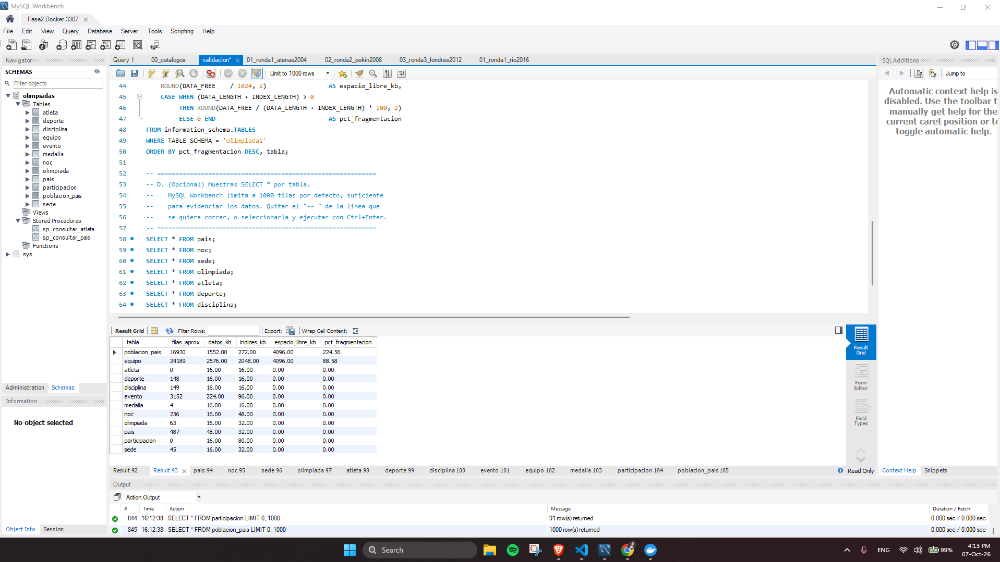

> **Advertencia:** No ejecute un mismo script de carga dos veces consecutivas, ya que producirá un error `Error Code: 1062. Duplicate entry`.

---

## 4. Guía de Validación Post-Carga y Fragmentación

Inmediatamente después de cada carga, se debe auditar la base de datos en Workbench con `Fase2/validacion.sql`:

1. **Refrescar estadísticas de InnoDB:**
   En una pestaña de Workbench, ejecutar:
   ```sql
   ANALYZE TABLE olimpiadas.atleta, olimpiadas.participacion, olimpiadas.pais,
     olimpiadas.equipo, olimpiadas.evento, olimpiadas.poblacion_pais;
   ```
2. **Ejecutar `Fase2/validacion.sql`:**
   Produce dos conjuntos de resultados:
   - **Grilla 1 — Censo de Filas:** Muestra el `COUNT(*)` exacto de cada una de las 12 tablas.
   - **Grilla 2 — Fragmentación:** Muestra el tamaño de datos (`DATA_LENGTH`), tamaño de índices (`INDEX_LENGTH`), espacio libre (`DATA_FREE`) y el porcentaje de fragmentación.
3. **Toma de Captura:**
   Presionar `Win + Impr Pant` asegurando que la grilla de resultados y el **reloj de la barra de tareas de Windows** sean perfectamente visibles. Guardar en `Fase2/evidencias/<ciclo>/`.

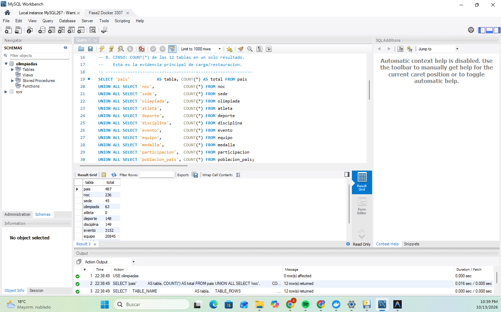

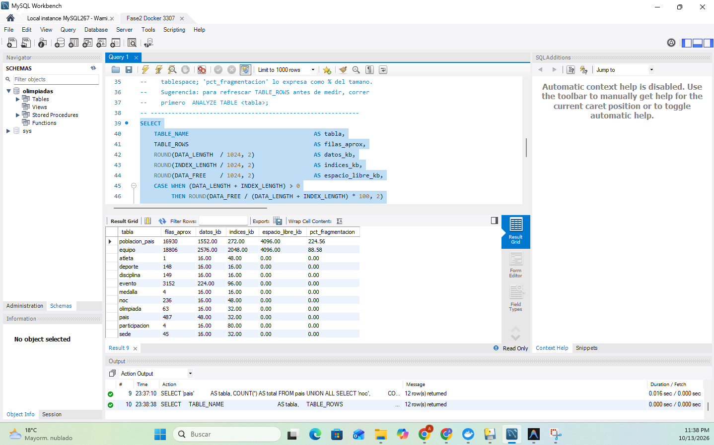

---

## 5. Guía de Ejecución de Respaldos Físicos en Consola

Los respaldos se ejecutan desde PowerShell en la raíz del repositorio, **nunca mediante interfaces gráficas**:

### 5.1 Respaldo Completo (Full Backup)
Se ejecuta obligatoriamente **tras la carga de catálogos (C0)**:
```powershell
.\Fase2\backup\scripts\backup-full.ps1
```
- Genera un directorio con nombre `full_yyyyMMdd_HHmmss` en `Fase2/backup/archivos/`.
- Registra el tamaño, fecha y resultado `OK` en `Fase2/logs/backup_manifest.csv`.

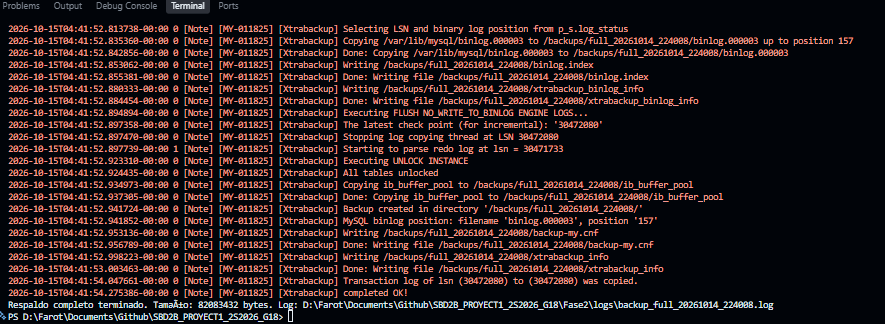

### 5.2 Respaldo Diferencial (Differential Backup)
Se ejecuta inmediatamente **después de cada ronda de hechos (C1, C2, C3)**:
```powershell
.\Fase2\backup\scripts\backup-differential.ps1
```
- Detecta automáticamente el último Full Backup generado y copia únicamente las páginas delta modificadas desde su LSN.
- Genera un directorio `diff_yyyyMMdd_HHmmss` en `Fase2/backup/archivos/`.
- Actualiza `Fase2/logs/backup_manifest.csv` asociando el campo `basado_en` con el Full correspondiente.

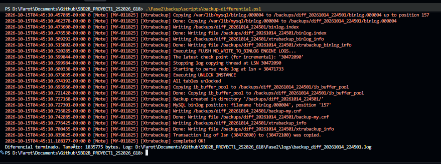
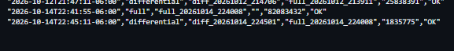

---

## 6. Guía de Restauración Física en Consola (Ambiente Aislado)

Para proteger los datos del equipo, la restauración se realiza sobre un contenedor aislado denominado `fase2_mysql_restore` y un volumen temporal `fase2_restore_mysql_data`.

### 6.1 Restaurar Respaldo Completo (C0)
```powershell
.\Fase2\restauracion\restore-full.ps1 -Ciclo <ciclo>
```
*Ejemplo:*
```powershell
.\Fase2\restauracion\restore-full.ps1 -Ciclo deportista
```

### 6.2 Restaurar Respaldo Diferencial (C1, C2, C3)
```powershell
.\Fase2\restauracion\restore-differential.ps1 -Ciclo <ciclo> -Ronda <ronda>
```
*Ejemplo:*
```powershell
.\Fase2\restauracion\restore-differential.ps1 -Ciclo anio -Ronda c3
```

### 6.3 Orquestación Automatizada con Pausa para Capturas
Para ejecutar la restauración guiada que permite tomar capturas con reloj visible:
```powershell
.\Fase2\restauracion\restaurar-y-validar-todo.ps1 -Ciclo anio -PausarParaCapturas
```
El script restaurará cada estado (C0, C1, C2, C3), pausará la consola diciendo `Presiona [ENTER] para continuar...`, permitiendo abrir Workbench, tomar las capturas del censo y fragmentación restaurados, y reanudar con la siguiente ronda.

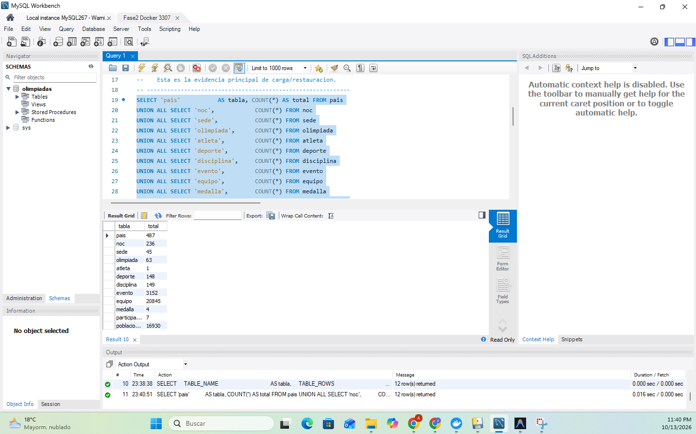

---

## 7. Guía de Auditoría Automatizada Post-Restauración

Para validar de forma instantánea y matemática que la base de datos restaurada no perdió ningún dato y tiene integridad referencial perfecta:

```powershell
.\Fase2\restauracion\validar-restauracion.ps1 -Ciclo <ciclo> -Carga <carga> -SaveReport
```
*Ejemplo:*
```powershell
.\Fase2\restauracion\validar-restauracion.ps1 -Ciclo deporte -Carga c2 -SaveReport
```

**Salida en Consola:**
- **Verde `[OK]`:** Las filas coinciden al 100% con la matriz oficial del Integrante 2.
- **Verde `[OK] 0 huérfanos`:** Se ejecutaron 7 consultas anti-join y ninguna fila de hechos quedó huérfana.
- **Rojo `[ERROR]`:** Se detectó una inconsistencia o pérdida de registros.
- **Reporte en Disco:** Guarda un log detallado en `Fase2/logs/validacion_<ciclo>_<carga>_<timestamp>.log`.

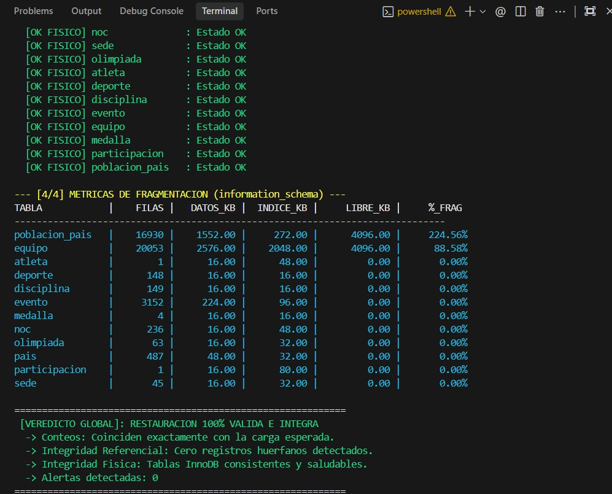

---

## 8. Interpretación de Registros y Logs del Sistema

1. **`Fase2/logs/backup_manifest.csv`:**
   Contiene el inventario de respaldos tomados:
   - `estrategia`: `full` o `differential`.
   - `respaldo`: Nombre de la carpeta del backup.
   - `basado_en`: Full del cual depende el diferencial.
   - `tamano_bytes`: Tamaño físico transferido a disco.
   - `resultado`: Debe indicar `OK`.

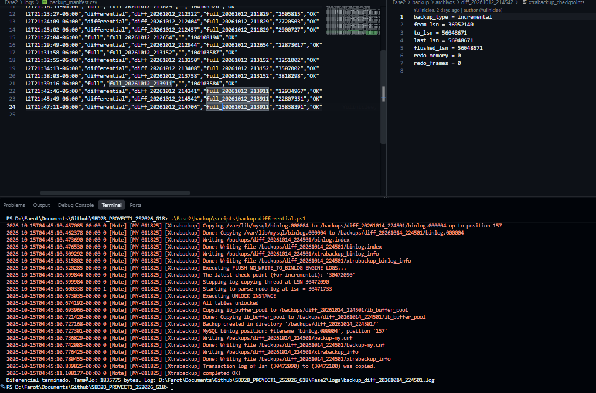

2. **`Fase2/logs/bitacora_restauracion.csv`:**
   Contiene el registro de las restauraciones y medición del RTO:
   - `duracion_segundos`: Tiempo exacto de recuperación medido con cronómetro de alta precisión.
   - `resultado`: Indica `OK` o el detalle del error en caso de fallo.

3. **`Fase2/logs/restore_*.log`:**
   Registro de bajo nivel de XtraBackup. La última línea siempre debe indicar:
   `completed OK!`.

4. **`Fase2/logs/validacion_*.log`:**
   Reportes detallados generados por `validar-restauracion.ps1 -SaveReport`. Almacenan:
   - Conteo exacto por tabla comparado contra el censo esperado.
   - Resultado de las 7 consultas anti-join (`0 huérfanos`).
   - Estado de salud física arrojado por `CHECK TABLE`.
   - Diagnóstico de fragmentación y espacio libre (`DATA_FREE`).

---

## 9. Guía de Solución de Problemas (Troubleshooting)

| Síntoma / Error | Causa Probable | Solución Paso a Paso |
|---|---|---|
| **`Bind for 0.0.0.0:3307 failed: port is already allocated`** | Un contenedor previo o proceso de MySQL quedó en ejecución bloqueando el puerto 3307. | Ejecutar en PowerShell:<br>`docker stop fase2_mysql_restore`<br>`docker rm -f fase2_mysql_restore` |
| **`Permission denied` en `/var/lib/mysql`** | XtraBackup ejecuta como UID 1001 y no puede escribir en el volumen Linux montado. | Los scripts de restauración ya incorporan `--user 0:0` y aplican automáticamente `chown -R 999:999` antes de levantar MySQL. |
| **`binlog.000004\r: No such file or directory`** | Fines de línea de Windows (CRLF) introdujeron un retorno de carro en `binlog.index`. | La función `New-WorkingCopy` de `_common_restore.ps1` sanitiza y elimina automáticamente los bytes `0x0D` de todos los archivos `*.index`. |
| **`Access denied for user 'root'@'...'` en Workbench tras restaurar** | La restauración física sobreescribió la tabla de contraseñas de MySQL con la que tenía el backup original. | `docker-compose.restore.yml` monta `init-restore.sql` con `--init-file`, restableciendo la contraseña a `admin` en cada arranque. |
| **`Duplicate entry '...' for key 'PRIMARY'` durante la carga** | Se ejecutó un script de carga dos veces o se cargó sobre un volumen que no estaba vacío. | Reiniciar el volumen con `docker compose down -v` y `.\Fase2\Start.bat` antes de iniciar la carga. |
