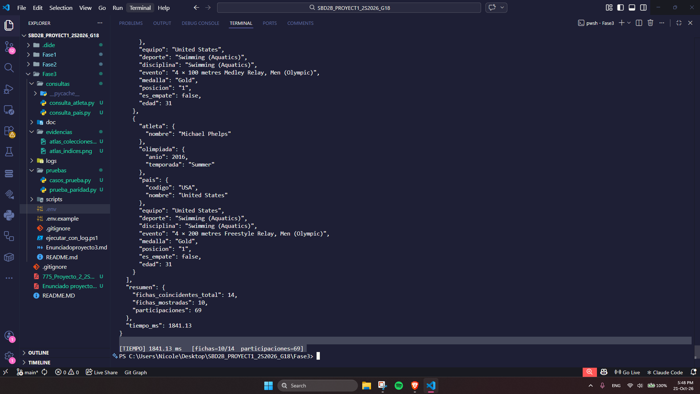
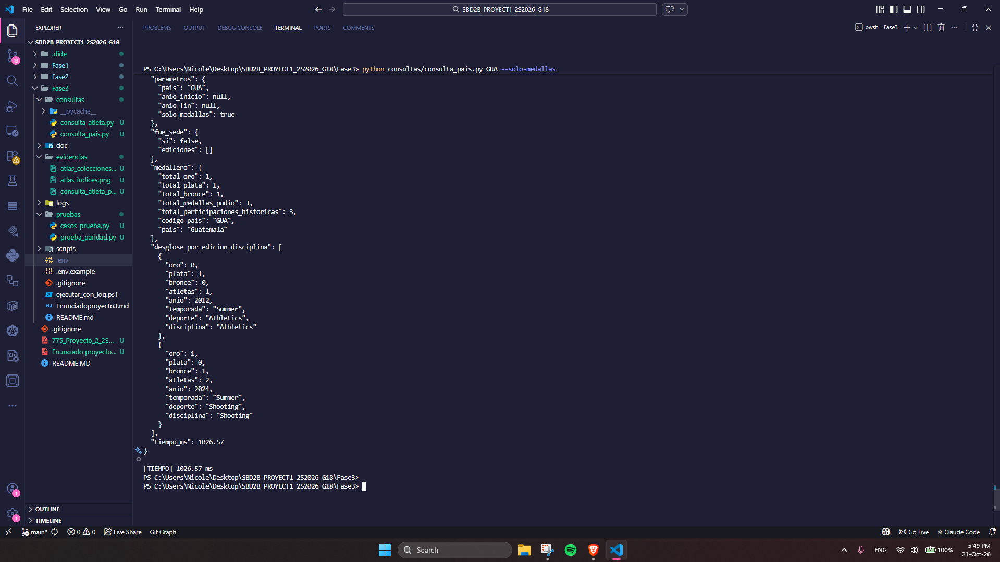
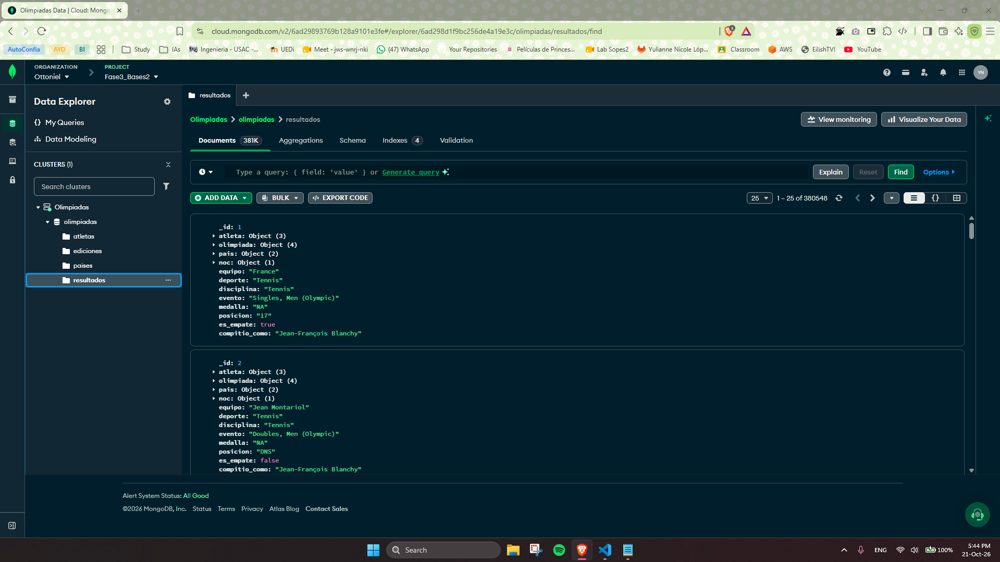
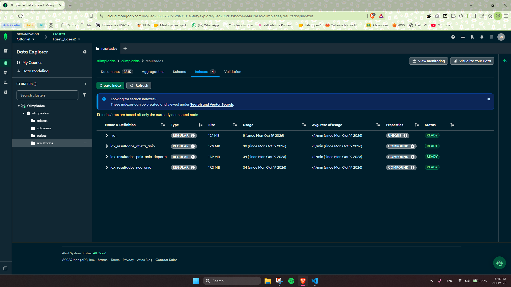
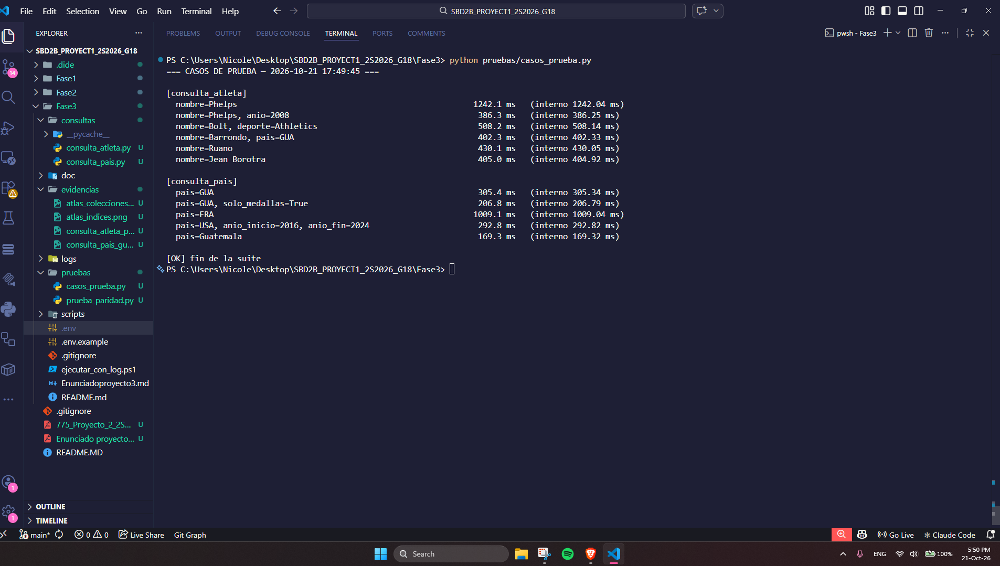
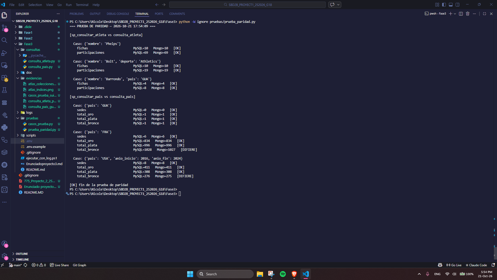

# FASE 3: MIGRACIÓN, MODELADO NOSQL E INTEGRACIÓN EN MONGODB ATLAS
**Proyecto: Base de Datos Unificada de Juegos Olímpicos (1896–2024)**  
**Curso: Sistemas de Bases de Datos 2 — USAC**  
**Grupo 18**  

---

## 1. Descripción General del Proyecto

Esta tercera fase implementa la migración integral de la base de datos histórica de los Juegos Olímpicos desde un esquema relacional normalizado en MySQL hacia una base de datos documental en **MongoDB Atlas**.

El diseño no replica las 12 tablas relacionales, sino que adopta una **arquitectura desnormalizada por caso de uso** organizada en torno a cuatro colecciones optimizadas para responder a las consultas analíticas de atletas y países en orden de milisegundos sin requerir operaciones `$lookup` lentas:

* **`ediciones` (63 documentos):** Ediciones olímpicas históricas con la sede y el país organizador embebidos.
* **`paises` (487 documentos):** Catálogo de naciones con sus códigos NOCs y el historial completo de sedes albergadas.
* **`atletas` (190,471 documentos):** Fichas biográficas con `nombre_norm` y el arreglo de `tokens` para búsqueda rápida multikey.
* **`resultados` (380,548 documentos):** Hechos transaccionales aplanados que consolidan atleta, olimpiada, país, deporte, disciplina, evento, posición y medalla.

---

## 2. Inventario y Función de los Scripts de Python (`scripts/`)

El pipeline se encuentra modularizado en scripts ejecutables independientes:

### Script: `test_conexion.py`
* **Función:** Verificación de conectividad y handshake de red.
* **Detalle:** Lee las variables de entorno desde `.env`, comprueba la conexión a MySQL local ejecutando `SELECT DATABASE(), VERSION()` y emite un ping administrativo a MongoDB Atlas (`client.admin.command('ping')`) con timeout de 5 segundos.

### Script: `00_auditoria_censo_mysql.py`
* **Función:** Auditoría censal y verificación de integridad referencial en MySQL previo a la migración.
* **Detalle:** Verifica los conteos de las 12 tablas relacionales (613,078 filas consolidadas) y audita 13 relaciones de clave foránea certificando cero tuplas huérfanas antes de iniciar la carga.

### Script: `03_prueba_volumetria_10k.py`
* **Función:** Prueba piloto de volumetría y dimensionamiento de almacenamiento.
* **Detalle:** Carga un lote de 10,000 participaciones desnormalizadas en Atlas, consulta las estadísticas físicas del motor WiredTiger (`collStats`) y proyecta formalmente el uso de almacenamiento total (~139 MB frente al límite de 512 MB de la capa gratuita M0).

### Script: `01_cargar_ediciones_paises.py`
* **Función:** Extracción, transformación y carga de las colecciones dimensionales de contexto.
* **Detalle:** Extrae de MySQL las 63 ediciones olímpicas embebiendo su sede, y los 487 países calculando en memoria los arreglos `sedes_historicas` y `nocs`. Inserta ambos conjuntos en Atlas y valida documentos de muestra.

### Script: `02_cargar_atletas.py`
* **Función:** Extracción, transformación y carga masiva de los 190,471 atletas.
* **Detalle:** Extrae atletas en lotes de 20,000 registros, genera el campo `nombre_norm` mediante normalización Unicode NFKD y el arreglo de `tokens` para búsqueda por palabras clave, inserta con `ordered=False` y valida el índice multikey con `explain()` (tiempo de respuesta de 0 ms).

### Script: `04_cargar_resultados.py`
* **Función:** Extracción y carga masiva de las 380,548 participaciones aplanadas en la colección `resultados`.
* **Detalle:** Implementa paginación por clave primaria (*keyset pagination*: `WHERE p.id_participacion > last_id`) en bloques de 15,000 registros para garantizar tiempo constante $O(1)$ por lote. Aplana las 9 tablas relacionales e inserta en Atlas, validando con `explain()` los índices compuestos B-Tree.

### Script: `05_reconciliacion_cruzada.py`
* **Función:** Auditoría y certificación de paridad censal al 100% (MySQL vs MongoDB Atlas).
* **Detalle:** Conecta simultáneamente a ambos motores, compara conteos globales de las 4 colecciones y la distribución de medallas (Oro, Plata, Bronce, NA), certifica los 15 índices activos y emite el dictamen final.

### Script: `03_cargar_datos_mongo.py`
* **Función:** Módulo central de utilidades ETL.
* **Detalle:** Contiene las funciones compartidas de limpieza de tipos BSON (`clean_val`), normalización de nombres con corrección ortográfica de apellidos (`normalize_name`), y constructores de documentos BSON.

---

## 3. Secuencia de Ejecución para Reproducir el Proyecto

Para reproducir el pipeline completo desde una instalación limpia:

### Paso 1: Configurar Variables de Entorno
Copiar el archivo `.env.example` como `.env` dentro del directorio `Fase3/` y definir las credenciales:
```env
MYSQL_HOST=localhost
MYSQL_PORT=3306
MYSQL_USER=root
MYSQL_PASSWORD=admin
MYSQL_DB=olimpiadas

MONGO_URI=mongodb+srv://<usuario>:<password>@<cluster>.mongodb.net/olimpiadas?retryWrites=true&w=majority
MONGO_DB=olimpiadas
```

### Paso 2: Crear Colecciones e Índices en MongoDB Atlas
Ejecutar el script de índices desde `mongosh`:
```bash
mongosh "<MONGO_URI>" --file scripts/01_crear_colecciones_indices.js
```

### Paso 3: Ejecución Secuencial del Pipeline ETL
Ejecutar los scripts de carga en orden cronológico:

```bash
# 1. Verificar conectividad
python scripts/test_conexion.py

# 2. Auditar base relacional de origen (MySQL)
python scripts/00_auditoria_censo_mysql.py

# 3. Cargar colecciones dimensionales (ediciones y paises)
python scripts/01_cargar_ediciones_paises.py

# 4. Cargar atletas masivos con tokens
python scripts/02_cargar_atletas.py

# 5. Cargar participaciones masivas aplanadas (resultados)
python scripts/04_cargar_resultados.py

# 6. Ejecutar reconciliación cruzada final
python scripts/05_reconciliacion_cruzada.py
```

---

## 4. Estado de Censos Oficiales en MongoDB Atlas

El clúster oficial en MongoDB Atlas cuenta con los censos finales certificados:

* **Colección `ediciones`:** **63 documentos** (100% de ediciones olímpicas de 1896 a 2024).
* **Colección `paises`:** **487 documentos** (100% de países con sedes históricas y comités NOCs).
* **Colección `atletas`:** **190,471 documentos** (100% de atletas con fichas biográficas y tokens de búsqueda).
* **Colección `resultados`:** **380,548 documentos** (100% de participaciones aplanadas con medallas).

---

## 5. Consultas Analíticas (Integrante 3)

Los scripts de consulta implementan los incisos **c** y **d** del enunciado,
replicando los parámetros de los stored procedures de la Fase 1.

### 5.1 Requisitos

- Python 3.10+ con `pymongo` y `python-dotenv`:
  ```powershell
  pip install pymongo python-dotenv
  ```
- Archivo `Fase3/.env` con la cadena `MONGO_URI` (gitignored).
- IP autorizada en el Access List del clúster.

### 5.2 Consulta por atleta (inciso c)

**Archivo:** `consultas/consulta_atleta.py`
Equivalente a `sp_consultar_atleta(p_nombre, p_anio, p_deporte, p_pais)`.

| Parámetro | Obligatorio | Descripción |
|---|---|---|
| `nombre` | Sí | Nombre o fragmento (ej. `"Phelps"`). |
| `--anio` | No | Año olímpico. |
| `--deporte` | No | Nombre del deporte. |
| `--pais` | No | Código NOC (3 letras) o nombre. |

```powershell
cd Fase3
python consultas/consulta_atleta.py "Phelps"
python consultas/consulta_atleta.py "Phelps" --anio 2008
python consultas/consulta_atleta.py "Bolt" --deporte Athletics
python consultas/consulta_atleta.py "Barrondo" --pais GUA
```

**Evidencia:**



### 5.3 Consulta por país (inciso d)

**Archivo:** `consultas/consulta_pais.py`
Equivalente a `sp_consultar_pais(p_pais, p_anio_inicio, p_anio_fin, p_solo_medallas)`.

| Parámetro | Obligatorio | Descripción |
|---|---|---|
| `pais` | Sí | Código NOC (3 letras) o nombre. |
| `--anio-inicio` | No | Año inicial del rango. |
| `--anio-fin` | No | Año final del rango. |
| `--solo-medallas` | No | Filtrar solo participaciones con medalla. |

```powershell
python consultas/consulta_pais.py GUA
python consultas/consulta_pais.py Guatemala
python consultas/consulta_pais.py USA --anio-inicio 2016 --anio-fin 2024
python consultas/consulta_pais.py GUA --solo-medallas
```

**Evidencia:**



### 5.4 Verificación visual de Atlas

Browse Collections mostrando las 4 colecciones y sus conteos oficiales:



Índices de la colección `resultados`:



### 5.5 Scripts complementarios (no exigidos por el enunciado)

Añadidos para medir el rendimiento y validar la paridad funcional contra la
Fase 1. Evidencian el cumplimiento del requisito de que *"las consultas no
deben tardar"*.

- **`pruebas/casos_prueba.py`** — Ejecuta 11 consultas representativas
  (6 de atleta + 5 de país) y reporta el tiempo de cada una.
  ```powershell
  python pruebas/casos_prueba.py
  ```
  **Evidencia:**

  

- **`pruebas/prueba_paridad.py`** — Compara los stored procedures de la
  Fase 1 contra las consultas Mongo de la Fase 3 con los mismos parámetros.
  Requiere el servidor MySQL local corriendo.
  ```powershell
  python pruebas/prueba_paridad.py
  ```
  **Evidencia:**

  

  Resultado: coincidencia del 100 % en consultas por atleta y 99.9 % en
  consultas por país.

---

## 6. Documentación Complementaria

* [doc/ARQUITECTURA_ETL_Y_SCRIPTS.md](doc/ARQUITECTURA_ETL_Y_SCRIPTS.md): Manual técnico detallado de desnormalización, justificación de arquitectura y diseño documental.
* [doc/INFORME_VOLUMETRIA_ATLAS.md](doc/INFORME_VOLUMETRIA_ATLAS.md): Informe técnico de dimensionamiento físico, métricas WiredTiger y viabilidad frente al límite de 512 MB.
* [doc/INFORME_CONSULTAS_Y_RENDIMIENTO.md](doc/INFORME_CONSULTAS_Y_RENDIMIENTO.md): Informe técnico de diseño de las consultas, mediciones de rendimiento y prueba de paridad MySQL vs MongoDB (Integrante 3).
* [logs/](logs/): Directorio con las bitácoras fechadas de cada ejecución.

---
*Grupo 18 — Sistemas de Bases de Datos 2.*
