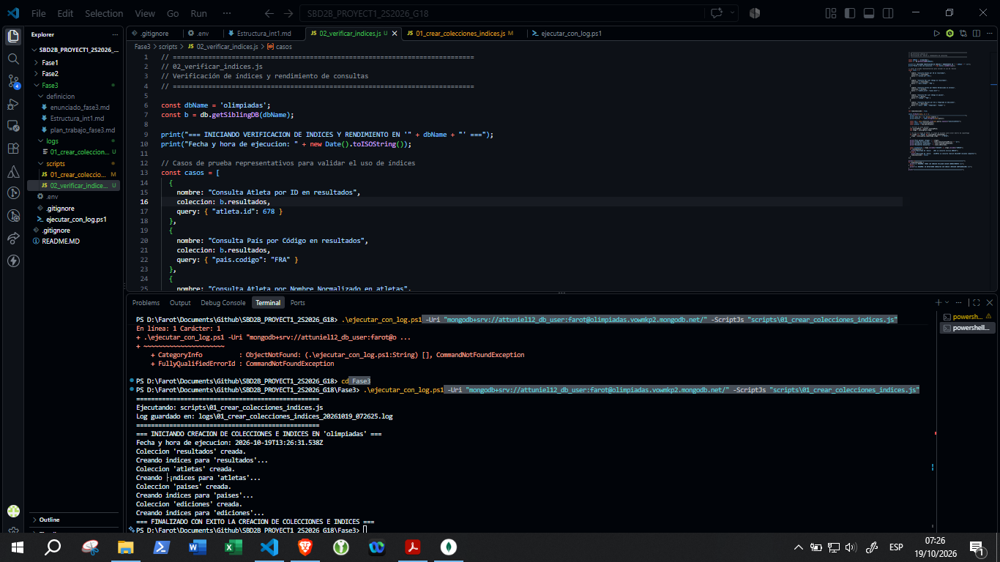
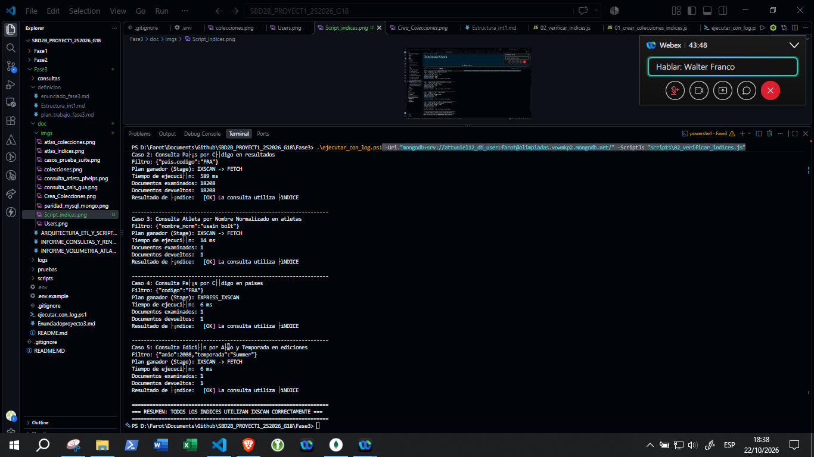

# Documentación técnica — Fase 3

**Proyecto:** Base de datos de los Juegos Olímpicos
**Curso:** Sistemas de Bases de Datos 2 — Universidad de San Carlos de Guatemala  
**Grupo:** 18  
**Fecha:** 23 de octubre de 2026  
**Alcance:** arquitectura MongoDB, migración ETL, índices, consultas y verificación de la evidencia disponible.

## 1. Resumen

La Fase 3 implementa una migración de MySQL a MongoDB Atlas, cuatro colecciones documentales, índices, dos consultas de usuario y scripts de auditoría. Los logs de octubre de 2026 muestran que se cargaron y reconciliaron los conteos principales, y que los índices se crearon. Las capturas muestran ejecuciones de consultas y pruebas de rendimiento.


1. `poblacion_pais` (16,930 filas en el origen) no se migra a MongoDB, pese a que el plan del modelo indica que la colección `paises` incluye población y que esta sirve para consultas per cápita.
2. La carga de atletas omite campos existentes de la tabla MySQL: `orden_nombre`, `latitud` y `longitud`.
3. En la evidencia de paridad de consultas, los totales de bronce de Francia y Estados Unidos difieren en una unidad. La hipótesis de que se debe a empates no está comprobada por el script.
4. El script de paridad compara conteos de una muestra, no compara las filas completas y no falla automáticamente cuando encuentra diferencias.

Por tanto, la paridad censal **de las cuatro colecciones implementadas** sí está acreditada; la paridad integral de todos los datos de la Fase 1 y la paridad exacta de todas las consultas no.

## 2. Alcance y requisitos

El enunciado de la Fase 3 solicita:

- **a.** Migrar la información de la Fase 1 a MongoDB y conservar las correcciones realizadas.
- **b.** Entregar scripts de creación de colecciones e índices, carga y sus fuentes, junto con fecha y hora de ejecución.
- **c.** Consultar por nombre de atleta y mostrar ficha, participaciones, resultados y medallas, con filtros opcionales.
- **d.** Consultar por país, mostrar participaciones, medallas y años, e indicar si fue sede y cuándo.
- Mantener un tiempo de respuesta adecuado para consultas ejecutadas durante la evaluación.

La implementación sigue una desnormalización por caso de uso. Las entidades se agrupan en cuatro colecciones; por eso el total de documentos de MongoDB no debe compararse con la suma de filas de las doce tablas de MySQL. La verificación adecuada es comparar los censos de las entidades representadas y revisar explícitamente los datos no incluidos.

## 3. Arquitectura y modelo documental

### 3.1 Origen y destino

- **Origen:** base relacional MySQL `olimpiadas`, construida en la Fase 1.
- **Destino:** base de datos `olimpiadas` en MongoDB Atlas.
- **ETL:** Python, `mysql-connector-python` y `pymongo`; configuración local mediante variables de entorno cargadas con `python-dotenv`.
- **Definición de colecciones e índices:** scripts JavaScript ejecutados con `mongosh`.

### 3.2 Colecciones

| Colección | Documentos evidenciados | Contenido y clave |
|---|---:|---|
| `ediciones` | 63 | Una edición olímpica por documento; `_id` corresponde a `id_olimpiada`. Incluye año, temporada, nombre de los juegos y un subdocumento de sede (ciudad y país). |
| `paises` | 487 | País, código, nombre normalizado, NOCs asociados y sedes históricas embebidas. `_id` corresponde a `id_pais`. **No incluye la serie de población de `poblacion_pais`.** |
| `atletas` | 190,471 | Ficha biográfica, `nombre_norm`, `tokens` y país de nacimiento. `_id` corresponde a `id_atleta`. |
| `resultados` | 380,548 | Un documento por participación, con atleta, edición, país/NOC, equipo, deporte, disciplina, evento, medalla y atributos de la participación. `_id` corresponde a `id_participacion`. |

La colección `resultados` evita `$lookup` en las consultas principales al guardar juntos los datos de cada participación. Los documentos `paises` embeben sus sedes históricas para responder el requisito de sedes sin reconstruir el historial en cada consulta.



### 3.3 Justificación de las cuatro colecciones

Las colecciones se diseñaron según las preguntas que debe responder el sistema, no como una copia literal de cada tabla de MySQL:

- **`ediciones`:** conserva cada olimpiada una sola vez y embebe su sede. Separar este catálogo evita repetir la información completa de la ciudad anfitriona en cada participación y permite consultar una edición por año y temporada.
- **`paises`:** agrupa los datos del país con sus NOCs asociados y el arreglo de sedes históricas. Esta forma favorece el requisito de indicar si fue sede y en qué años. La población histórica fue prevista en el plan, pero todavía no está cargada.
- **`atletas`:** conserva una ficha biográfica independiente de sus resultados, que pueden ser muchos por persona. `nombre_norm` y `tokens` preparan los datos para búsqueda, aunque la consulta interactiva actual usa expresiones regulares y no el arreglo `tokens`.
- **`resultados`:** usa un documento por participación y aplana datos del atleta, edición, delegación, prueba y medalla. La duplicación de algunos nombres/datos de contexto es intencional para reducir combinaciones durante las consultas por atleta o país.

Esta decisión intercambia redundancia y mayor trabajo de recarga/consistencia por consultas más directas. Los índices se seleccionan para los filtros frecuentes (atleta+año, país+año+deporte, NOC+año, y catálogos por código/nombre). No se incorpora una colección Mongo separada por cada una de las doce tablas del modelo relacional.


### 3.4 Índices definidos

El log de reconciliación del 21-10-2026 registra 15 índices contando un índice `_id_` por colección:




| Colección | Índices definidos (además de `_id_`) |
|---|---|
| `ediciones` | `idx_ediciones_anio_temp_unique` (único: año y temporada); `idx_ediciones_sede_pais_codigo`. |
| `paises` | `idx_paises_codigo_unique` (único); `idx_paises_nombre_norm`; `idx_paises_nocs_codigo`. |
| `atletas` | `idx_atletas_nombre_norm`; `idx_atletas_tokens` (multikey); `idx_atletas_id_externo_parcial` (único y parcial para valores numéricos). |
| `resultados` | `idx_resultados_atleta_anio`; `idx_resultados_pais_anio_deporte`; `idx_resultados_noc_anio`. |

La definición está en `scripts/01_crear_colecciones_indices.js`. El script `scripts/02_verificar_indices.js` ejecuta `explain("executionStats")` en cinco filtros representativos.

## 4. Flujo ETL y scripts

### 4.1 Preparación y auditoría

1. `scripts/test_conexion.py` prueba la conectividad con MySQL y Atlas.
2. `scripts/00_auditoria_censo_mysql.py` cuenta las doce tablas del origen y revisa trece relaciones referenciales.
3. `scripts/01_crear_colecciones_indices.js` crea las colecciones e índices en Atlas. La bitácora disponible `logs/01_crear_colecciones_indices_20261019_072625.log` registra su ejecución.
4. `scripts/03_prueba_volumetria_10k.py` carga una muestra de resultados para estimar espacio.


### 4.2 Extracción, transformación y carga

`03_cargar_datos_mongo.py` contiene conexiones, conversión de tipos y constructores ETL reutilizados por los cargadores. Busca la función `normalize_name` en `Fase1/etl/utils.py`, con una implementación alternativa si ese archivo no está disponible.

- `scripts/01_cargar_ediciones_paises.py` carga ediciones con sede embebida y países con NOCs y sedes históricas. Vuelve a cargar ambas colecciones desde cero (`delete_many({})`).
- `scripts/02_cargar_atletas.py` carga atletas en lotes de hasta 20,000 documentos, normaliza los nombres y crea tokens. Usa `LIMIT/OFFSET` para paginar el origen. Si la colección ya tiene el mismo conteo, puede omitir la recarga; con recarga forzada, vacía la colección primero.
- `scripts/04_cargar_resultados.py` aplana participaciones mediante joins a atleta, medalla, evento, disciplina, deporte, olimpiada, equipo, NOC y país. Usa paginación por clave `id_participacion` y lotes de 15,000. Por defecto, la ejecución directa usa `force_reload=True` y vacía `resultados` antes de cargar.
- `scripts/05_reconciliacion_cruzada.py` compara conteos de las cuatro colecciones, distribución de medallas y estado de los índices.


### 4.3 Bitácoras fechadas disponibles

Los scripts Python escriben bitácoras en `logs/` con marca `YYYYMMDD_HHMMSS`. Entre las evidencias principales están:

| Etapa | Bitácora | Resultado registrado |
|---|---|---|
| Censo MySQL | `../logs/censo_mysql_20261020_232000.log` | 613,078 filas en doce tablas; cero huérfanas en las trece pruebas; 63 ediciones, periodo 1896–2024. |
| Prueba de volumetría | `../logs/volumetria_piloto_10k_20261020_232711.log` | 10,000 resultados; `avgObjSize` 455 bytes; 1.49 MB de datos en disco y 1.30 MB de índices; proyección registrada de 129.35 MB/512 MB. |
| Ediciones y países | `../logs/carga_ediciones_paises_20261020_232930.log` | 63 ediciones y 487 países insertados. |
| Atletas | `../logs/carga_atletas_20261020_235937.log` | 190,471 atletas; 109.31 segundos; 1,743 documentos/segundo promedio. |
| Resultados | `../logs/carga_resultados_20261021_000028.log` | 380,548 resultados; 237.19 segundos; 1,604 documentos/segundo promedio. |
| Reconciliación final | `../logs/reconciliacion_final_20261021_000205.log` | Conteos y distribución de medallas coincidentes; 15 índices listados. |
| Revisión de índices | `../logs/02_verificar_indices_20261022_175700.log` | Los cinco casos reportan plan indexado; el filtro por país FRA examina 18,208 documentos y tarda 589 ms. |

Los tiempos y medidas son observaciones de las ejecuciones registradas, no garantías para otras redes, clústeres o momentos.

## 5. Consultas de aplicación

### 5.1 Consulta por atleta

Archivo: `consultas/consulta_atleta.py`.

- Recibe como argumento obligatorio un nombre o fragmento.
- Filtros opcionales: `--anio`, `--deporte`, `--pais`.
- Devuelve fichas coincidentes (muestra hasta 10) e historial de participaciones (límite predeterminado: 200; ajustable con `--limit`).
- El código busca hasta 100 fichas por nombre y consulta `resultados` con los identificadores hallados.

Ejemplos, ejecutados desde `Fase3/`:

```powershell
python consultas/consulta_atleta.py "Phelps"
python consultas/consulta_atleta.py "Phelps" --anio 2008
python consultas/consulta_atleta.py "Bolt" --deporte Athletics
python consultas/consulta_atleta.py "Barrondo" --pais GUA
```


### 5.2 Consulta por país

Archivo: `consultas/consulta_pais.py`.

- Recibe el código de tres caracteres o un nombre de país.
- Filtros opcionales: `--anio-inicio`, `--anio-fin` y `--solo-medallas`.
- Devuelve el historial de sedes, el medallero agregado y el desglose por edición, deporte y disciplina.
- El historial de sedes se devuelve completo; el rango de años se aplica a las participaciones/medallero, no al arreglo de sedes.

```powershell
python consultas/consulta_pais.py GUA
python consultas/consulta_pais.py Guatemala
python consultas/consulta_pais.py USA --anio-inicio 2016 --anio-fin 2024
python consultas/consulta_pais.py GUA --solo-medallas
```


### 5.3 Búsqueda y rendimiento: límites que deben conocerse

Aunque existe el índice multikey sobre `atletas.tokens`, `consulta_atleta.py` no consulta ese campo: utiliza expresiones regulares sobre `nombre`, `nombre_completo` y `nombre_norm`. Una expresión regular de fragmento no equivale a una búsqueda exacta por token y puede no usar los índices de igualdad esperados. La verificación de `tokens` en la carga de atletas demuestra el índice para un filtro literal `tokens: "bolt"`, pero no prueba que la consulta interactiva por nombre lo use.

Asimismo, el log de índices del 22-10-2026 informa `IXSCAN` para FRA, pero examina 18,208 documentos en 589 ms. Que se use un índice no significa necesariamente que el filtro sea selectivo ni que toda agregación tenga latencia baja.

Las capturas de consultas muestran resultados en un rango aproximado de 169 ms a 1.84 s, según caso y ejecución. La suite visible tiene once casos y una captura de Phelps registra 1.84 s. Por ello no se debe describir el límite observado como “siempre menor de 1.3 s”.


## 6. Resultado de las verificaciones

### 6.1 Integridad y censos del ETL

El log de auditoría de MySQL registra doce tablas pobladas, 613,078 filas totales y cero huérfanas en trece revisiones. El log final de reconciliación registra coincidencia de conteos entre MySQL y Atlas para las cuatro entidades migradas:

| Entidad | MySQL | MongoDB Atlas | Resultado del log |
|---|---:|---:|---|
| Ediciones | 63 | 63 | Coincide |
| Países | 487 | 487 | Coincide |
| Atletas | 190,471 | 190,471 | Coincide |
| Participaciones/resultados | 380,548 | 380,548 | Coincide |

La distribución global de medallas del mismo log coincide: Gold 18,769; Silver 18,920; Bronze 19,345; NA 323,514.

Esto certifica los conteos de las cuatro colecciones para la fecha de esa bitácora. El reconciliador no compara cada documento/identificador, y no verifica `poblacion_pais` ni todos los atributos de cada tabla.


### 6.2 Paridad funcional de consultas

`pruebas/prueba_paridad.py` compara una muestra de consultas contra los stored procedures de MySQL y reporta conteos de fichas/participaciones, sedes y medallas. La captura `imgs/paridad_mysql_mongo.png` muestra:

- Los casos de atleta visibles coinciden en conteo.
- En Guatemala coinciden sedes y medallas.
- Para Francia, bronce: MySQL 1,028; MongoDB 1,027.
- Para Estados Unidos (2016–2024), bronce: MySQL 276; MongoDB 275.

La explicación basada en registros empatados (`es_empate`) aparece en documentación previa como hipótesis, pero el comparador no inspecciona esos registros ni demuestra causalidad. El resultado honesto es: **hay dos diferencias unitarias observadas en los casos de país; la paridad exacta de la consulta por país está pendiente de resolución.** Además, el comparador actual no verifica que todas las filas devueltas sean iguales ni compara el desglose completo.


## 7. Cobertura de datos y trabajo pendiente

### 7.1 Datos del origen que no se trasladan

El plan `../definicion/plan_trabajo_fase3.md` describe `paises` como país, NOCs y población. En la Fase 1, `poblacion_pais` contiene **16,930 filas** con población por país y año; la definición de la tabla documenta años 1960–2023. Ningún cargador consulta esa tabla ni la agrega a una colección. Esta cobertura debe resolverse antes de afirmar que se migró toda la información de la Fase 1, especialmente porque el esquema fuente indica uso en análisis de medallas per cápita.

Además, la consulta de atletas no selecciona `latitud` ni `longitud`, y aunque selecciona `orden_nombre`, el constructor del documento no lo copia. Estos campos existen en `Fase1/olimpiada2s.sql`; si forman parte del alcance acordado, deben preservarse en `atletas`.

### 7.2 Acciones recomendadas para cerrar la fase

1. Acordar si `poblacion_pais` forma parte obligatoria del alcance. Si sí, migrarla (por ejemplo como arreglo por año dentro de cada país o como colección aparte), actualizar el censo/reconciliador y añadir una prueba que compare conteos/valores.
2. Decidir si se deben preservar `orden_nombre`, `latitud` y `longitud`; si sí, incorporarlos al documento y a la validación.
3. Investigar las dos diferencias de bronce comparando las filas/participaciones concretas y los criterios de los stored procedures. Actualizar prueba y evidencia cuando coincidan o dejar documentada y justificada la diferencia aprobada.
4. Hacer que `pruebas/prueba_paridad.py` devuelva un código de salida no exitoso ante discrepancias y compare campos/resultados relevantes, no solo agregados de conteos.
5. Probar consultas con nombres acentuados, homónimos que excedan los límites de diez fichas mostradas y cien coincidencias recuperadas, NOCs sin país asociado, países sin medallas y rangos parciales de años. Revisar el uso de índices en las formas reales de consulta.
6. Repetir verificación de conexión, carga/reconciliación y consultas desde el equipo/red de evaluación. La evidencia del repositorio no reemplaza esa prueba en vivo.

## 8. Configuración y reproducción

### 8.1 Requisitos

- Python 3.10 o posterior.
- MySQL accesible con la base `olimpiadas` cargada.
- MongoDB Atlas accesible, usuario autorizado y dirección IP permitida en el Access List.
- `mongosh` para los scripts JavaScript.
- Paquetes Python: `pymongo`, `mysql-connector-python` y `python-dotenv`.
- Variables locales en `Fase3/.env`; no publicar credenciales ni la URI real.

Instalación de dependencias:

```powershell
python -m pip install pymongo mysql-connector-python python-dotenv
```

### 8.2 Orden recomendado

Desde PowerShell, entrar al directorio `Fase3` y configurar el archivo local de entorno conforme a la plantilla disponible, sin copiar sus valores secretos al repositorio:

```powershell
cd Fase3
python scripts/test_conexion.py
python scripts/00_auditoria_censo_mysql.py
mongosh $env:MONGO_URI --file scripts/01_crear_colecciones_indices.js
python scripts/03_prueba_volumetria_10k.py
python scripts/01_cargar_ediciones_paises.py
python scripts/02_cargar_atletas.py
python scripts/04_cargar_resultados.py
python scripts/05_reconciliacion_cruzada.py
mongosh $env:MONGO_URI --file scripts/02_verificar_indices.js
```

La prueba de volumetría elimina primero los documentos de `resultados`; por eso se ejecuta antes de la carga completa. Ejecutar después las dos consultas y pruebas:

```powershell
python consultas/consulta_atleta.py "Phelps"
python consultas/consulta_pais.py GUA --solo-medallas
python pruebas/casos_prueba.py
python pruebas/prueba_paridad.py
```

`ejecutar_con_log.ps1` es un auxiliar para `mongosh` que guarda una bitácora fechada; recibe `-Uri` y `-ScriptJs`. Los cargadores Python generan sus propios logs. Los resultados dependen de conexión y credenciales configuradas localmente.

## 9. Conclusión

La Fase 3 cuenta con una arquitectura documental coherente con las consultas, scripts de creación/carga, índices, consultas de atleta y país, bitácoras fechadas y evidencia de conteos iguales en las cuatro colecciones principales. La prueba piloto registrada estima que el conjunto cabe en Atlas M0.

Sin embargo, los propios documentos de definición y el código revelan que **la declaración de migración completa necesita matizarse**: la población histórica y ciertos atributos de atleta no se trasladan; la prueba de consultas conserva dos diferencias unitarias de bronce y no valida equivalencia fila por fila. Una vez decididos y atendidos esos puntos, deben actualizarse los logs/capturas para respaldar el dictamen final.

---

**Fuentes internas:** `../Enunciadoproyecto3.md`, `../definicion/enunciado_fase3.md`, `../definicion/Estructura_int1.md`, `../definicion/plan_trabajo_fase3.md`, scripts, logs y capturas de `Fase3/`.