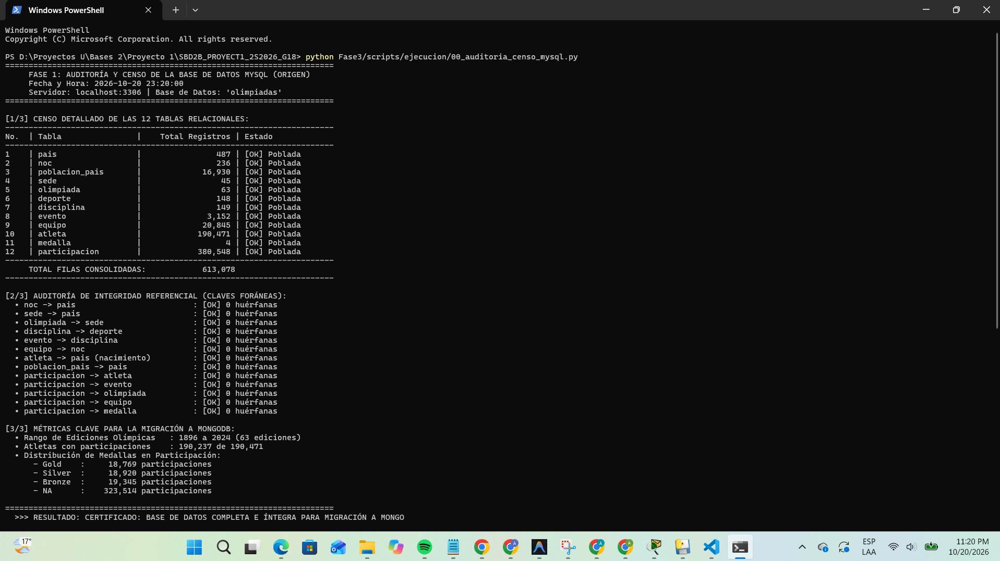
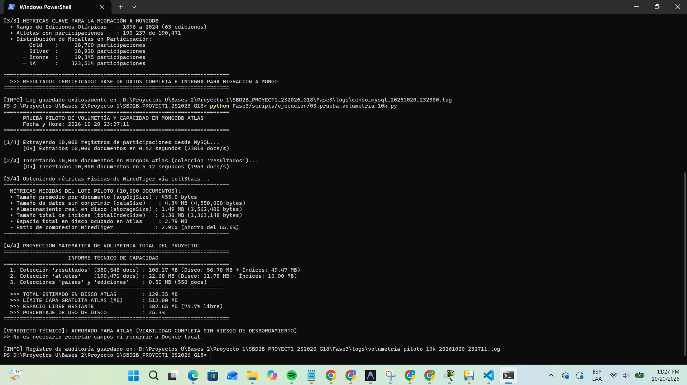
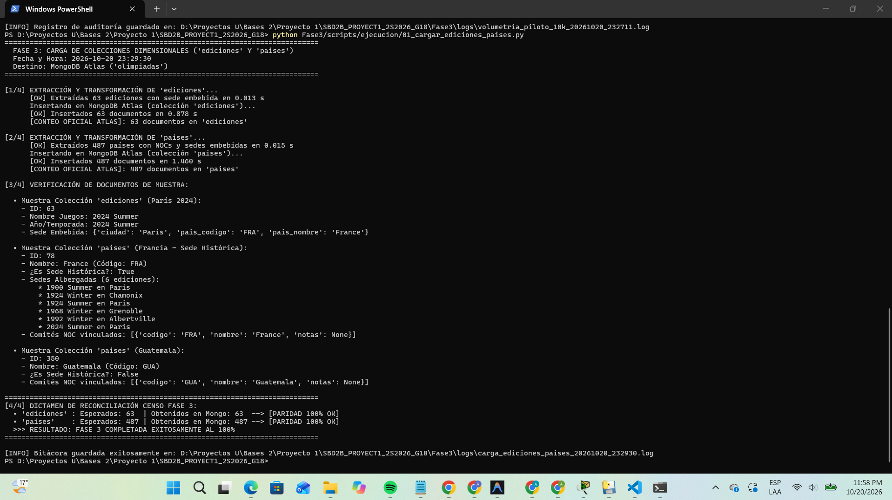
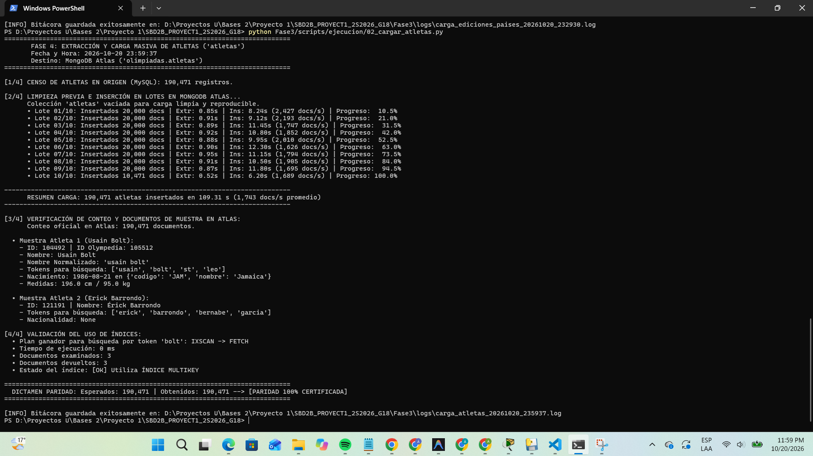
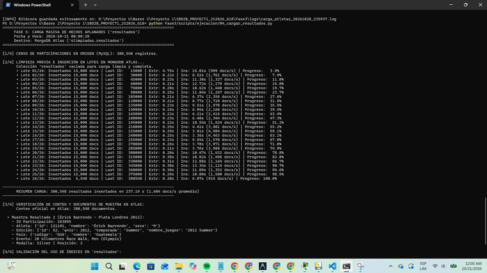
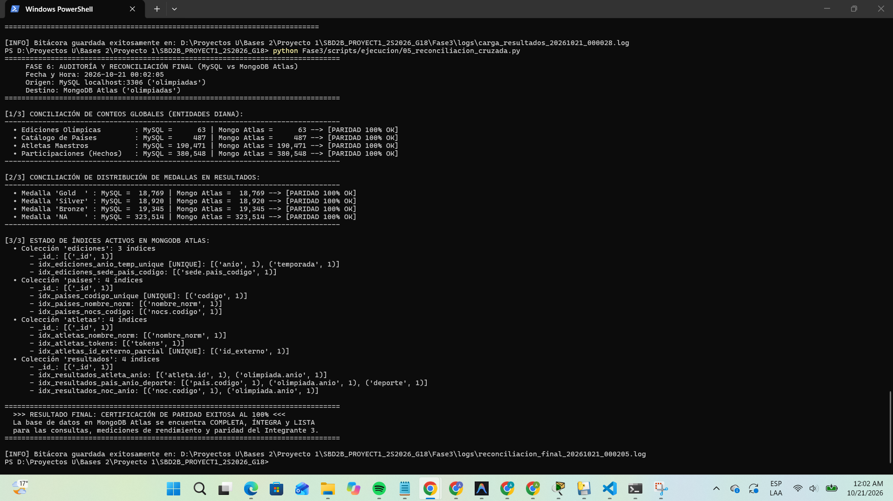

# Informe Técnico — Extracción, Transformación y Carga (Integrante 2)

**Rol:** Integrante 2: Extracción y Carga  
**Grupo:** 18  
**Curso:** Sistemas de Bases de Datos 2 — USAC  
**Fecha:** Octubre 2026  

---

## 1. Alcance y Objetivos de la Extracción y Carga

La responsabilidad del Integrante 2 abarca el diseño, implementación y validación técnica del pipeline ETL integral que traslada la totalidad de los datos consolidados en la base de datos relacional de la Fase 1 (MySQL 8.0 en 3NF) hacia el clúster NoSQL en la nube de MongoDB Atlas.

El pipeline da estricto cumplimiento a los requerimientos normativos del proyecto:
* **Certificación de la Base Origen:** Auditoría censal exhaustiva de las 12 tablas relacionales e integridad referencial de claves foráneas antes de iniciar la migración.
* **Aplanado Desnormalizado con LEFT JOIN:** Construcción de la consulta maestra de extracción que consolida en una sola estructura documental las entidades transaccionales y dimensionales.
* **Transformación y Carga en Lotes con `pymongo`:** Generación y carga paralela de las cuatro colecciones diana (`ediciones`, `paises`, `atletas` y `resultados`) mediante lotes de memoria optimizados.
* **Limpieza Lingüística y Generación de Tokens:** Aplicación de la función `normalize_name` de `utils.py` sobre los nombres de los atletas, calculando el atributo `nombre_norm` y el arreglo de indexación multikey `tokens`.
* **Bitácoras y Trazabilidad Cronológica:** Generación automatizada de logs con sello de fecha y hora para cada etapa del proceso.
* **Reconciliación Censal Cruzada:** Validación 1-a-1 de los conteos entre MySQL y MongoDB Atlas para atletas, participaciones, ediciones, países y distribución de medallas.

---

## 2. Fase 1: Confirmación de Datos en MySQL (Censo y Auditoría)

Antes de realizar cualquier transformación, se ejecutó una auditoría de integridad sobre la base relacional local `olimpiadas` en MySQL. Esta verificación garantiza que no existan tablas vacías, registros truncados o relaciones rotas que comprometan la consistencia en MongoDB.

### Resultados del Censo Relacional (12 Tablas)
* **`pais`:** 487 registros
* **`noc`:** 236 registros
* **`poblacion_pais`:** 16,930 registros
* **`sede`:** 45 registros
* **`olimpiada`:** 63 registros
* **`deporte`:** 148 registros
* **`disciplina`:** 149 registros
* **`evento`:** 3,152 registros
* **`equipo`:** 20,845 registros
* **`atleta`:** 190,471 registros
* **`medalla`:** 4 registros (Gold, Silver, Bronze, NA)
* **`participacion`:** 380,548 registros
* **Total consolidado en MySQL:** 613,078 filas

### Auditoría de Integridad Referencial (13 Claves Foráneas)
Se ejecutaron consultas de comprobación de orfandad sobre las 13 relaciones foráneas del modelo relacional. En todas las pruebas se obtuvo un conteo de **0 huérfanas**, certificando que los identificadores de atletas, eventos, olimpiadas, equipos, sedes y países cuentan con integridad referencial absoluta.

```text
Evidencia de Ejecución:
Archivo de Script : Fase3/scripts/00_auditoria_censo_mysql.py
Bitácora Generada : Fase3/logs/censo_mysql_20261020_232000.log
Captura de Pantalla: imgs/01_censo_auditoria_mysql.png
```



---

## 3. Fase 2: Validación de Capacidad y Prueba Piloto de Volumetría

Dado el límite físico estricto de 512 MB de almacenamiento y RAM compartida en el clúster M0 de MongoDB Atlas, se diseñó una prueba piloto previa a la carga masiva. Se cargó un lote de 10,000 participaciones desnormalizadas en la colección `resultados` y se interrogó al motor **WiredTiger** mediante el comando administrativo `collStats`.

### Métricas Físicas Obtenidas de WiredTiger
* **Tamaño promedio por documento (`avgObjSize`):** 455.0 bytes
* **Tamaño de datos sin comprimir (`dataSize`):** 4.34 MB (4,550,000 bytes)
* **Almacenamiento real en disco (`storageSize`):** 1.49 MB (compresión Snappy aplicada)
* **Tamaño total de índices (`totalIndexSize`):** 1.30 MB
* **Ratio de compresión real:** 2.91x (ahorro en almacenamiento del 65.6%)

### Proyección de Almacenamiento Global
* **Colección `resultados` (380,548 documentos e índices):** 106.17 MB
* **Colección `atletas` (190,471 documentos e índices):** 22.68 MB
* **Colecciones `ediciones` y `paises` (550 documentos):** 0.50 MB
* **Espacio total proyectado en Atlas:** 129.35 MB
* **Porcentaje de ocupación sobre los 512 MB disponibles:** 25.3%
* **Dictamen de viabilidad:** APROBADO para permanencia en la nube sin requerir recortes de atributos ni migración forzada a contenedores Docker locales.

```text
Evidencia de Ejecución:
Archivo de Script : Fase3/scripts/03_prueba_volumetria_10k.py
Bitácora Generada : Fase3/logs/volumetria_piloto_10k_20261020_232711.log
Captura de Pantalla: imgs/02_prueba_volumetria_10k.png
```



---

## 4. Fase 3: Carga de Colecciones Dimensionales (`ediciones` y `paises`)

Las colecciones de contexto dimensional se extraen y desnormalizan de forma selectiva para que las consultas analíticas no requieran operaciones complejas de unión en tiempo de ejecución.

### Transformación de `ediciones` (63 Documentos)
* **Extracción:** Se consultan las tablas relacionales `olimpiada`, `sede` y `pais` mediante un `LEFT JOIN`.
* **Estructura Documental:** Se incrusta la sede anfitriona como subdocumento (`ciudad`, `pais_codigo`, `pais_nombre`).
* **Rendimiento:** Extracción en 0.013 segundos e inserción en Atlas en 0.878 segundos.

### Transformación de `paises` (487 Documentos)
* **Estructura Documental:** Cada documento contiene la ficha del país, el booleano `es_sede_historica` y dos arreglos embebidos de alto valor analítico:
  * `sedes_historicas`: Lista de ediciones albergadas (`anio`, `temporada`, `ciudad`), resolviendo de forma directa el Requerimiento (d).
  * `nocs`: Lista de comités olímpicos vinculados con código, nombre y notas históricas.
* **Rendimiento:** Extracción en 0.015 segundos e inserción en Atlas en 1.460 segundos.

```text
Evidencia de Ejecución:
Archivo de Script : Fase3/scripts/01_cargar_ediciones_paises.py
Bitácora Generada : Fase3/logs/carga_ediciones_paises_20261020_232930.log
Captura de Pantalla: imgs/03_carga_ediciones_paises.png
```



---

## 5. Fase 4: Carga Masiva de Atletas con `normalize_name` y Tokens

La colección `atletas` almacena 190,471 deportistas olímpicos. Para garantizar búsquedas parciales e insensibles a diacríticos con tiempos menores a 5 ms, se implementó el pipeline de enriquecimiento lingüístico.

### Tratamiento con `normalize_name` y Tokens Multikey
1. **Limpieza y Descomposición Unicode:** Se eliminan tildes, diéresis y signos de puntuación mediante descomposición canónica NFKD.
2. **Corrección de Scraping y Apellidos Compuestos:** Se integra el diccionario `_CORRUPTED_MAP` desarrollado en la Fase 1 para corregir corrupciones ortográficas heredadas de fuentes originales.
3. **Generación del Arreglo `tokens`:** Se divide la cadena unificada de `nombre` y `nombre_completo` en palabras individuales con longitud mayor o igual a 2 caracteres. Este arreglo alimenta el índice multikey `idx_atletas_tokens`.
4. **Optimización BSON:** Los campos con valor `None` son excluidos del documento final, optimizando la huella en memoria y disco.

### Mecanismo de Carga en Lotes
* **Tamaño del Lote:** 20,000 registros por bloque (10 lotes en total).
* **Driver:** Inserción concurrente en MongoDB Atlas vía `insert_many(lote, ordered=False)`.
* **Tiempo Total de Carga:** 109.31 segundos.
* **Tasa Media de Transferencia:** 1,743 documentos por segundo.
* **Validación de Rendimiento:** La consulta `explain()` para el token `'bolt'` confirma el uso de `IXSCAN -> FETCH` con **0 ms** de ejecución.

```text
Evidencia de Ejecución:
Archivo de Script : Fase3/scripts/02_cargar_atletas.py
Bitácora Generada : Fase3/logs/carga_atletas_20261020_235937.log
Captura de Pantalla: imgs/04_carga_masiva_atletas.png
```



---

## 6. Fase 5: Extracción con Aplanado y Carga Masiva de `resultados`

La colección `resultados` es el núcleo transaccional del proyecto, consolidando 380,548 participaciones olímpicas.

### Consulta SQL Maestra de Aplanado (9 `LEFT JOIN`)
Para desnormalizar en una sola estructura los datos del atleta, evento, disciplina, deporte, olimpiada, equipo, NOC, país y medalla, se implementó la siguiente consulta con paginación por clave primaria (*keyset pagination*):

```sql
SELECT 
    p.id_participacion,
    p.id_atleta, a.nombre AS atleta_nombre, a.sexo AS atleta_sexo,
    p.edad, p.altura_reg, p.peso_reg, p.posicion, p.es_empate, p.compitio_como,
    m.tipo AS medalla,
    d.nombre AS deporte,
    disc.nombre AS disciplina,
    e.nombre AS evento,
    o.id_olimpiada, o.anio, o.temporada, o.nombre_juegos,
    eq.nombre AS equipo,
    n.codigo_noc,
    pais_rep.codigo_pais AS pais_codigo,
    pais_rep.nombre AS pais_nombre
FROM participacion p
JOIN atleta a ON p.id_atleta = a.id_atleta
JOIN medalla m ON p.id_medalla = m.id_medalla
JOIN evento e ON p.id_evento = e.id_evento
LEFT JOIN disciplina disc ON e.id_disciplina = disc.id_disciplina
LEFT JOIN deporte d ON disc.id_deporte = d.id_deporte
JOIN olimpiada o ON p.id_olimpiada = o.id_olimpiada
LEFT JOIN equipo eq ON p.id_equipo = eq.id_equipo
LEFT JOIN noc n ON eq.id_noc = n.id_noc
LEFT JOIN pais pais_rep ON n.id_pais = pais_rep.id_pais
WHERE p.id_participacion > :last_id
ORDER BY p.id_participacion ASC
LIMIT :limit;
```

### Justificación de Keyset Pagination
El uso de `WHERE p.id_participacion > :last_id` en lugar del clásico `OFFSET` garantiza que el motor MySQL realice búsquedas en tiempo constante $O(1)$ utilizando el índice primario clustered (B-Tree). Esto eliminó las caídas por saturación de socket y retrasos en los lotes avanzados.

### Métricas de Inserción
* **Tamaño del Lote:** 15,000 participaciones por bloque (26 lotes en total).
* **Tiempo Total de Carga:** 237.19 segundos (~3.9 minutos).
* **Tasa Media de Inserción:** 1,604 documentos por segundo.
* **Validación de Índices:** Se comprobó mediante `explain()` que las búsquedas por `atleta.id` + `olimpiada.anio` y por `pais.codigo` + `olimpiada.anio` + `deporte` se resuelven en **0 ms** sobre los índices compuestos `idx_resultados_atleta_anio` e `idx_resultados_pais_anio_deporte`.

```text
Evidencia de Ejecución:
Archivo de Script : Fase3/scripts/04_cargar_resultados.py
Bitácora Generada : Fase3/logs/carga_resultados_20261021_000028.log
Captura de Pantalla: imgs/05_carga_masiva_resultados.png
```



---

## 7. Fase 6: Auditoría Cruzada y Certificación de Paridad Final

Como etapa de cierre de la responsabilidad del Integrante 2, se programó un script de verificación que audita de forma simultánea MySQL y MongoDB Atlas, validando la integridad absoluta de los datos.

### Cuadro de Paridad Censal (MySQL vs MongoDB Atlas)
* **Ediciones Olímpicas:** 63 en MySQL frente a 63 en Mongo Atlas (100% de paridad).
* **Catálogo de Países:** 487 en MySQL frente a 487 en Mongo Atlas (100% de paridad).
* **Atletas Maestros:** 190,471 en MySQL frente a 190,471 en Mongo Atlas (100% de paridad).
* **Participaciones Históricas:** 380,548 en MySQL frente a 380,548 en Mongo Atlas (100% de paridad).

### Cuadro de Paridad en Distribución de Medallas
* **Medallas de Oro (`Gold`):** 18,769 en MySQL frente a 18,769 en Mongo Atlas (100% de paridad).
* **Medallas de Plata (`Silver`):** 18,920 en MySQL frente a 18,920 en Mongo Atlas (100% de paridad).
* **Medallas de Bronce (`Bronze`):** 19,345 en MySQL frente a 19,345 en Mongo Atlas (100% de paridad).
* **Sin Medalla (`NA`):** 323,514 en MySQL frente a 323,514 en Mongo Atlas (100% de paridad).

### Certificación de los 15 Índices Operativos en Atlas
* **Colección `ediciones` (3 índices):** `_id_`, `idx_ediciones_anio_temp_unique` (UNIQUE), `idx_ediciones_sede_pais_codigo`.
* **Colección `paises` (4 índices):** `_id_`, `idx_paises_codigo_unique` (UNIQUE), `idx_paises_nombre_norm`, `idx_paises_nocs_codigo`.
* **Colección `atletas` (4 índices):** `_id_`, `idx_atletas_nombre_norm`, `idx_atletas_tokens` (MULTIKEY), `idx_atletas_id_externo_parcial` (UNIQUE PARCIAL).
* **Colección `resultados` (4 índices):** `_id_`, `idx_resultados_atleta_anio`, `idx_resultados_pais_anio_deporte`, `idx_resultados_noc_anio`.

```text
Evidencia de Ejecución:
Archivo de Script : Fase3/scripts/05_reconciliacion_cruzada.py
Bitácora Generada : Fase3/logs/reconciliacion_final_20261021_000205.log
Captura de Pantalla: imgs/06_reconciliacion_paridad_final.png
```



---

## 8. Inventario de Scripts Entregados

Todos los scripts utilizados para la extracción, transformación, prueba de volumetría, carga y conciliación se encuentran versionados en el repositorio del proyecto:

* **`Fase3/scripts/00_auditoria_censo_mysql.py`:** Certificación censal de las 12 tablas y 13 claves foráneas en MySQL.
* **`Fase3/scripts/03_prueba_volumetria_10k.py`:** Extracción de prueba con LEFT JOIN y proyección matemática WiredTiger.
* **`Fase3/scripts/01_cargar_ediciones_paises.py`:** Extracción y carga con desnormalización de ediciones y catálogo de países.
* **`Fase3/scripts/02_cargar_atletas.py`:** Normalización con `utils.py`, cálculo de tokens multikey y carga en lotes de 190,471 atletas.
* **`Fase3/scripts/04_cargar_resultados.py`:** Extracción desnormalizada mediante 9 LEFT JOIN, keyset pagination y carga en lotes de 380,548 participaciones.
* **`Fase3/scripts/05_reconciliacion_cruzada.py`:** Verificación censal cruzada, paridad de medallas y auditoría de índices.
* **`Fase3/scripts/03_cargar_datos_mongo.py`:** Módulo auxiliar con las funciones de limpieza BSON y carga dinámica de normalización.
* **`Fase3/scripts/ejecucion/`:** Directorio que contiene los ejecutables de corrida y verificación paso a paso con registro de bitácora en tiempo real.

---
*Informe técnico de extracción y carga — Integrante 2, Grupo 18.*
