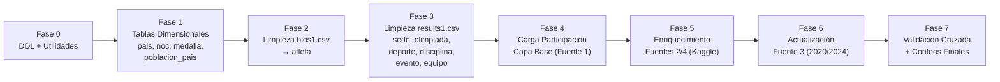

# Plan de Implementación ETL — Olimpiadas G18 (Persona 2)

> **Alcance:** Extracción, limpieza y carga de 4 fuentes de datos olímpicos a MySQL.  
> **Ejecución:** Fase por fase, con revisión y documentación entre cada una.  
> **Datos de trabajo:** Carpeta `data_samples/` (muestras de 5 filas para desarrollo; los scripts se diseñan para funcionar con los CSVs completos cuando se restauren).

---

## Visión General de Fases



---

## Fase 0: Ejecución del DDL y Módulo de Utilidades Comunes

**Objetivo:** Crear la base de datos, ejecutar el DDL, e implementar las funciones reutilizables.

### Entregables
| Archivo | Descripción |
|---|---|
| `etl/utils.py` | Funciones comunes: conexión MySQL, reparación mojibake, normalización de nombres, lookup con cache |
| `etl/fase0_ddl.py` | Ejecuta `olimpiada2s.sql` contra MySQL para crear la BD y las 12 tablas |

### Detalle de `utils.py`
```python
# Funciones a implementar:
fix_mojibake(text)        # encode cp1252 → decode utf-8, quitar bullet
normalize_name(name)      # minúsculas, NFKD, quitar acentos/puntuación
get_connection()          # conexión MySQL con charset utf8mb4
safe_insert(cursor, sql, params)  # INSERT IGNORE / ON DUPLICATE KEY
```

### Verificación
- [ ] Base de datos `olimpiadas` creada
- [ ] 12 tablas existen con estructura correcta
- [ ] Semilla `medalla` insertada (4 registros: Gold, Silver, Bronze, NA)

---

## Fase 1: Carga de Tablas Dimensionales (pais, noc, poblacion_pais)

**Objetivo:** Poblar las tablas de catálogo que no dependen de datos de atletas.

### Entrada
| Archivo | Columnas usadas |
|---|---|
| `noc_regions_sample.csv` | `NOC`, `region`, `notes` |
| `populations_sample.csv` | `Country Name`, `Country Code`, `1960`…`2023` |

### Transformaciones

#### Tabla `pais`
1. De `noc_regions.csv`: cada `region` única → `pais.nombre`, `NOC` → `pais.codigo_pais`
2. De `populations.csv`: cada `Country Code` único → verificar si ya existe en `pais.codigo_pais`; si no, insertar con `nombre = Country Name`
3. Aplicar `fix_mojibake()` a todos los nombres

#### Tabla `noc`
1. De `noc_regions.csv`: `NOC` → `noc.codigo_noc`, `region` → `noc.nombre_noc`, `notes` → `noc.notas`
2. Enlazar `noc.id_pais` buscando `pais.codigo_pais = NOC` (cuando el código NOC coincide con el código de país)

#### Tabla `poblacion_pais`
1. Aplicar `pandas.melt()` sobre las columnas `1960`…`2023`
2. Cruzar `Country Code` → `pais.codigo_pais` → obtener `id_pais`
3. Insertar `(id_pais, anio, poblacion)` para cada fila resultante
4. Los Country Codes sin match en `pais` se reportan en log pero no bloquean

### Verificación
- [ ] Tabla `pais` con N registros únicos
- [ ] Tabla `noc` con N registros, cada uno con `id_pais` válido (o NULL para NOCs sin país)
- [ ] Tabla `poblacion_pais` con registros pivoteados
- [ ] Cero violaciones de FK

---

## Fase 2: Limpieza de `bios1.csv` y Carga de `atleta`

**Objetivo:** Procesar la data cruda biográfica y poblar la tabla `atleta` (catálogo maestro).

### Entrada
| Archivo | Columnas | Destino |
|---|---|---|
| `bios_sample.csv` | 16 columnas crudas | `atleta` |
| `bios_locs_sample.csv` | `athlete_id`, `lat`, `long` | merge → `atleta.latitud`, `atleta.longitud` |

### Transformaciones (en orden)

1. **Mojibake:** `fix_mojibake()` sobre todas las columnas de texto
2. **Parseo de `Born`:**
   - Regex fecha: `r'(\d+ \w+ \d{4}|\d{4})'` → convertir a `DATE` → `atleta.fecha_nac`
   - Regex lugar: `r'in ([\w\s()-]+), ([\w\s-]+) \((\w+)\)'` → `ciudad_nac`, `region_nac`, código país nacimiento
   - Buscar/crear `pais` para código país nacimiento → `atleta.id_pais_nac`
3. **Parseo de `Died`:** Misma regex de fecha → `atleta.fecha_muerte`
4. **Parseo de `Measurements`:** `r'(\d+) cm / (\d+) kg'` → `atleta.altura_cm`, `atleta.peso_kg`
5. **Nombres:**
   - `Used name` (quitando bullet `•`) → `atleta.nombre`
   - `Full name` → `atleta.nombre_completo`
6. **Sexo:** `'Male'` → `'M'`, `'Female'` → `'F'`
7. **Columnas directas:** `Roles` → `roles`, `Affiliations` → `afiliacion`, `Nick/petnames` → `apodo`, `Title(s)` → `titulo`, `Other names` → `otros_nombres`, `Nationality` → `nacionalidad`, `Original name` → `nombre_original`, `Name order` → `orden_nombre`
8. **Merge con `bios_locs`:** Por `athlete_id` → agregar `latitud`, `longitud`
9. **`id_externo`:** `athlete_id` de Olympedia
10. **Lookup de `NOC`:** El campo `NOC` de bios1 contiene el **nombre del país** (ej: `"France"`), no el código. No se carga en la tabla `atleta` (no tiene FK a noc), pero servirá en Fase 3 para vincular participaciones.

### Verificación
- [ ] Validar que `nombre` no tiene bullets ni mojibake
- [ ] Comparar primeros 5 registros con `bios_clean_sample.csv` (fechas, ciudades, medidas deben coincidir)
- [ ] `id_externo` poblado para todos los registros de Fuente 1
- [ ] `sexo` solo contiene `'M'` o `'F'`

---

## Fase 3: Limpieza de `results1.csv` y Carga de Tablas de Contexto

**Objetivo:** Procesar resultados crudos y poblar `sede`, `olimpiada`, `deporte`, `disciplina`, `evento`, `equipo`.

### Entrada
| Archivo | Columnas clave |
|---|---|
| `results.csv_sample.csv` | `Games`, `Event`, `Team`, `Discipline`, `NOC` |

### Transformaciones

#### Tabla `sede`
1. Parsear `Games` → extraer la parte textual después de año y temporada (ej: `"1912 Summer Olympics"`)
2. **Problema:** `results1.csv` NO contiene `City` directamente. El campo `Games` solo dice `"1912 Summer Olympics"`, no la ciudad.
3. **Solución:** Las ciudades se obtienen de `athlete_events.csv` (Fuente 2, que sí tiene `City`). Se pre-carga un mapeo `(Year, Season) → City` desde Fuente 2 para resolver las sedes.
4. Cada ciudad única → buscar/crear `pais` para el país anfitrión → insertar `sede(ciudad, id_pais)`

#### Tabla `olimpiada`
1. Parsear `Games`: `r'(\d{4}) (\w+)'` → `anio`, `temporada`
2. `nombre_juegos` = valor original del campo `Games`
3. Enlazar con `id_sede` obtenido del mapeo anterior
4. `UNIQUE(anio, temporada)` previene duplicados

#### Tabla `deporte`
1. De Fuente 1: `Discipline` (de results1) es en realidad la disciplina/deporte de Olympedia
2. De Fuentes 2/3: `Sport` es el deporte
3. Unificar nombres únicos → insertar en `deporte`

#### Tabla `disciplina`
1. De Fuente 1: `Discipline` → `disciplina.nombre`, enlazada a `deporte` con el mismo nombre (o se busca mapeo)
2. Disciplina puente: cuando una fuente solo trae `Sport` → `disciplina.nombre = Sport`
3. `UNIQUE` sobre `(nombre, id_deporte)` para evitar duplicados

#### Tabla `evento`
1. `Event` → `evento.nombre`, enlazado a `id_disciplina`
2. Nombres de evento únicos por disciplina

#### Tabla `equipo`
1. `Team` → `equipo.nombre`
2. `NOC` → buscar `noc.codigo_noc` → `equipo.id_noc`
3. `UNIQUE(nombre, id_noc)` previene duplicados

### Verificación
- [ ] Comparar resultados parseados con `results_clean_sample.csv` (año, temporada, disciplina, evento deben coincidir)
- [ ] `sede` contiene ciudades históricas reales
- [ ] `olimpiada` no tiene duplicados `(anio, temporada)`
- [ ] Toda `disciplina` tiene `id_deporte` poblado
- [ ] Todo `evento` tiene `id_disciplina` poblado

---

## Fase 4: Carga de `participacion` — Capa Base (Fuente 1)

**Objetivo:** Insertar las participaciones históricas desde `results1.csv` en la tabla de hechos.

### Entrada
| Archivo | Columnas usadas |
|---|---|
| `results.csv_sample.csv` | `Games`, `Event`, `Team`, `Pos`, `Medal`, `As`, `athlete_id`, `NOC`, `Discipline` |

### Transformaciones
1. **Lookup `id_atleta`:** Por `athlete_id` (cruzando `atleta.id_externo`)
2. **Lookup `id_evento`:** Por `Event` + `Discipline` → encontrar `evento` correcto
3. **Lookup `id_olimpiada`:** Por parseo de `Games` → `(anio, temporada)`
4. **Lookup `id_equipo`:** Por `Team` + `NOC` → `equipo(nombre, id_noc)`
5. **Lookup `id_medalla`:** `Medal` → homologar → buscar `medalla.tipo`
6. **`compitio_como`:** Columna `As`
7. **Posición y empate:**
   - Si `Pos` contiene `=` → `es_empate = TRUE`, `posicion = Pos.replace('=', '')`
   - Si `Pos` es texto (`DNS`, `DNF`, etc.) → `posicion = Pos`, `es_empate = FALSE`
8. **`edad`, `altura_reg`, `peso_reg`:** NULL en esta fase (Fuente 1 no los tiene). Se llenan en Fase 5.

### Verificación
- [ ] Cada participación tiene FK válidas a atleta, evento, olimpiada, equipo, medalla
- [ ] Comparar con `results_clean_sample.csv` para validar coherencia
- [ ] `es_empate` = TRUE solo donde `Pos` original contenía `=`

---

## Fase 5: Enriquecimiento — Fuentes 2 y 4 (Kaggle `athlete_events.csv`)

**Objetivo:** Cruzar `athlete_events.csv` para agregar `edad`, `altura_reg`, `peso_reg` a las participaciones existentes, y agregar nuevos atletas/participaciones que solo existan en Kaggle.

### Entrada
| Archivo | Columnas nuevas |
|---|---|
| `athlete_events_sample.csv` | `Age`, `Height`, `Weight`, `City`, `Sport` |

### Transformaciones
1. **Mojibake + normalización:** `fix_mojibake()` y `normalize_name()` sobre `Name`
2. **Deduplicación de atleta:** Construir matching key `(nombre_normalizado, sexo, NULL)` (no hay fecha nacimiento en esta fuente)
   - Si match → reutilizar `id_atleta`, actualizar campos nulos (ej: si `atleta.altura_cm` es NULL y Kaggle tiene `Height`)
   - Si no match → insertar nuevo `atleta` con `id_externo = NULL`, `nombre = Name`, `sexo = Sex`
3. **Sedes:** `City` aporta la ciudad que faltaba en Fuente 1 → verificar/crear `sede`
4. **Deporte/Disciplina/Evento:** `Sport` → `deporte`, disciplina puente, `Event` → `evento`
5. **Participaciones existentes (UPDATE):** Si ya existe una participación con mismo `(id_atleta, id_evento, id_olimpiada)` → actualizar `edad = Age`, `altura_reg = Height`, `peso_reg = Weight`
6. **Participaciones nuevas (INSERT):** Si no existe → insertar con todos los campos

> [!IMPORTANT]
> **Fuente 4 (DataCamp)** es idéntica a Fuente 2. Se omite su procesamiento independiente (DT-015).

### Verificación
- [ ] Participaciones enriquecidas tienen `edad`, `altura_reg`, `peso_reg` poblados
- [ ] No se duplicaron participaciones existentes
- [ ] Nuevos atletas de Kaggle insertados correctamente

---

## Fase 6: Actualización — Fuente 3 (Kaggle `olympics_dataset.csv` — 2020/2024)

**Objetivo:** Incorporar medallistas y resultados de Tokio 2020 y París 2024.

### Entrada
| Archivo | Columnas clave |
|---|---|
| `olympics_dataset.csv` | `player_id`, `Name`, `Sex`, `Team`, `NOC`, `Year`, `Season`, `City`, `Sport`, `Event`, `Medal` |

### Transformaciones
1. **Filtro temporal:** Priorizar registros de `Year >= 2020` (los anteriores ya vienen de Fuentes 1/2)
2. **Deduplicación de atleta:** Matching key `(nombre_normalizado, sexo, NULL)`
3. **Medalla:** `'No medal'` → `'NA'`
4. **Nuevas sedes:** Tokio, París → verificar/crear en `sede`
5. **Nuevas olimpiadas:** 2020 Summer, 2024 Summer → verificar/crear en `olimpiada`
6. **Participaciones:** Insertar solo si no existen aún `(id_atleta, id_evento, id_olimpiada)`

> [!NOTE]
> También se procesan registros pre-2020 de esta fuente como fallback: si un atleta/evento no existía en las fuentes anteriores, se inserta.

### Verificación
- [ ] Existen olimpiadas para 2020 y 2024
- [ ] Medallistas de Tokio y París correctamente cargados
- [ ] Sin duplicados contra datos de Fuentes 1/2

---

## Fase 7: Validación Cruzada y Conteos Finales

**Objetivo:** Verificar integridad, generar reportes de conteo, y documentar resultados.

### Validaciones
1. **Integridad referencial:** Consultar que no haya FKs huérfanas en ninguna tabla
2. **Conteos esperados:**
   ```sql
   SELECT 'pais' AS tabla, COUNT(*) FROM pais
   UNION SELECT 'noc', COUNT(*) FROM noc
   UNION SELECT 'sede', COUNT(*) FROM sede
   UNION SELECT 'olimpiada', COUNT(*) FROM olimpiada
   UNION SELECT 'atleta', COUNT(*) FROM atleta
   UNION SELECT 'deporte', COUNT(*) FROM deporte
   UNION SELECT 'disciplina', COUNT(*) FROM disciplina
   UNION SELECT 'evento', COUNT(*) FROM evento
   UNION SELECT 'equipo', COUNT(*) FROM equipo
   UNION SELECT 'participacion', COUNT(*) FROM participacion
   UNION SELECT 'poblacion_pais', COUNT(*) FROM poblacion_pais
   UNION SELECT 'medalla', COUNT(*) FROM medalla;
   ```
3. **Validación cruzada con Fuente 4 (DataCamp):** Comparar conteos de atletas/eventos por año con los de Fuente 2
4. **Validación contra olympics.com:** Spot-check manual de medalleros de ediciones clave
5. **Prueba de Stored Procedures:** Ejecutar queries de prueba para verificar que los datos soportan las consultas de Persona 3

### Entregables Finales
- [ ] Documento `decisiones_tecnicas.md` actualizado con todas las decisiones
- [ ] Scripts Python en carpeta `etl/` documentados
- [ ] Reporte de conteos y validación

---

## Estructura de Archivos del Proyecto

```
SBD2B_PROYECT1_2S2026_G18/
├── olimpiada2s.sql                    # DDL (Persona 1)
├── DiagramaER.png                     # Diagrama ER actualizado (Persona 1)
├── decisiones_tecnicas.md             # Decisiones técnicas (Persona 2) ← NUEVO
├── aclaracionesTecnicas.md            # Aclaraciones técnicas previas
├── Explicacion.md                     # Documento explicativo general
├── README.md                          # Instrucciones del proyecto
├── data_samples/                      # Muestras de datos (5 filas)
│   ├── bios_sample.csv                # Fuente 1: bios crudo
│   ├── bios_locs_sample.csv           # Fuente 1: bios con lat/long
│   ├── bios_clean_sample.csv          # Fuente 1: referencia limpia
│   ├── results.csv_sample.csv         # Fuente 1: results crudo
│   ├── results_clean_sample.csv       # Fuente 1: referencia limpia
│   ├── noc_regions_sample.csv         # Fuente 1: catálogo NOC
│   ├── populations_sample.csv         # Fuente 1: poblaciones BM
│   ├── athlete_events_sample.csv      # Fuente 2: Kaggle 120 Years
│   ├── olympics_dataset.csv           # Fuente 3: Kaggle Summer 2024
│   └── athlete_events_datalab_sample.csv  # Fuente 4: DataCamp (= F2)
└── etl/                               # Scripts ETL (Persona 2) ← NUEVO
    ├── utils.py                       # Fase 0: utilidades comunes
    ├── fase0_ddl.py                   # Fase 0: ejecutar DDL
    ├── fase1_dimensionales.py         # Fase 1: pais, noc, poblacion_pais
    ├── fase2_atletas.py               # Fase 2: limpieza bios → atleta
    ├── fase3_contexto.py              # Fase 3: sede, olimpiada, deporte, disciplina, evento, equipo
    ├── fase4_participacion_base.py    # Fase 4: participacion (Fuente 1)
    ├── fase5_enriquecimiento.py       # Fase 5: participacion (Fuentes 2/4)
    ├── fase6_actualizacion.py         # Fase 6: participacion (Fuente 3)
    └── fase7_validacion.py            # Fase 7: validación y conteos
```

---

## Resumen de Ejecución

| Fase | Script | Tablas afectadas | Fuente(s) | Estado |
|------|--------|-----------------|-----------|--------|
| 0 | `fase0_ddl.py` + `utils.py` | Todas (DDL) | `olimpiada2s.sql` | ✅ Completada |
| 1 | `fase1_dimensionales.py` | `pais`, `noc`, `poblacion_pais` | `noc_regions`, `populations` | ✅ Completada |
| 2 | `fase2_atletas.py` | `atleta` | `bios1`, `bios_locs` | ✅ Completada |
| 3 | `fase3_contexto.py` | `sede`, `olimpiada`, `deporte`, `disciplina`, `evento`, `equipo` | `results1`, `athlete_events` | ✅ Completada |
| 4 | `fase4_participacion_base.py` | `participacion` | `results1` | ✅ Completada |
| 5 | `fase5_enriquecimiento.py` | `atleta`, `participacion` | `athlete_events` | ⬜ Pendiente |
| 6 | `fase6_actualizacion.py` | `atleta`, `participacion`, `sede`, `olimpiada` | `olympics_dataset` | ⬜ Pendiente |
| 7 | `fase7_validacion.py` | Lectura | Todas | ⬜ Pendiente |
